# Geçidin Muhafızı

**Kocaeli Üniversitesi, Teknoloji Fakültesi, Bilişim Sistemleri Mühendisliği**
**Ders:** Yazılım Geliştirme Laboratuvarı-I, Proje 1
**Ekip:** Şerife Aleyna ÖN
**Tarih:** Kasım 2026
**GitHub:** https://github.com/serifealeynaon/YazLab1-Proje1

## Çalıştırma

1. Ollama'yı kurun ve modeli indirin: `ollama pull llama3.2:3b`
2. Teslim dosyasındaki `Builds` klasöründen sürümü açın (Windows: `YazLabOyun.exe`, Mac: `YazLabOyun.app`).
3. Kontroller: `WASD` yürüme, `E` companion'a emir verme veya yanındayken mührü alma, `T` muhafızla konuşma, `Enter` mesaj gönderme, `Esc` sohbeti kapatma.

Unity sürümü: `6000.0.85f2`. Sahne, `YazLab > Sahneyi Kur` menüsüyle yeniden üretilebilir.

## 1. Giriş

### Problem ve amaç

Proje, tek bir Unity macera oyununda birbirinden bağımsız iki yapay zekâ bileşenini bir araya getirir: NavMesh ile yol bulan otonom bir companion ve yerel dil modeliyle konuşan bir NPC. Amaç, model çıktısını oyun durumuna güvenilir biçimde bağlamak ve model ya da sunucu sorun çıkardığında oyunu çalışır tutmaktır.

### Oyun senaryosu

1. **Fiziksel engel:** Oyuncunun önünde kilitli bir kapı vardır. Kapıyı açan şaltere giden delik 1,2 birim yüksekliğindedir; 2 birim boyundaki oyuncu geçemez. Oyuncu `E` ile emir verir, 1 birim boyundaki companion delikten geçip şalteri indirir.
2. **Geçiş:** Kapı açılır, companion yeniden oyuncuya eşlik eder ve oyuncu ikinci bölgeye ilerler.
3. **Mühür:** İkinci bölgede altın renkli kralın mührü durur. Oyuncu yanına gidip `E` ile alır. Ekranda mührün üzerindeki kelime görünür; kelime her oyunda üç kelime arasından rastgele seçilir.
4. **Mantıksal engel:** İkinci kapıyı muhafız Kerem korur. Oyuncu serbest metinle konuşur. Muhafız kelimeyi sorar. Kapı, oyuncu mührü almışsa ve modelin döndürdüğü JSON'daki `door_unlocked` alanı `true` ise açılır. Kelimeyi tanıma kararı modelindir, kod metinde kelime aramaz; kod yalnızca mühür alınmadan kapının açılmasını engeller.
5. **Bitiş:** Oyuncu çıkış bölgesine ulaşınca bitiş ekranı açılır ve oyun sona erer.

### Mimari

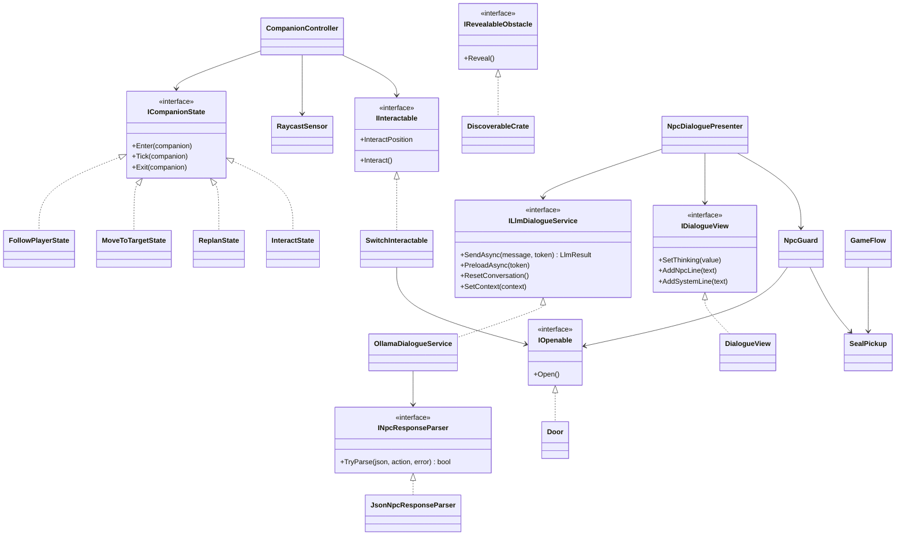

Companion ve LLM bileşenleri birbirini tanımaz. `GameFlow` yalnızca senaryo akışını ve oyuncu girdisini yönetir.

## 2. Otonom companion

### Karar mekanizması

Companion, NavMesh ve sonlu durum makinesiyle çalışır. Her durum `ICompanionState` arayüzünü uygular; yeni durum eklemek için `CompanionController` değiştirilmez.

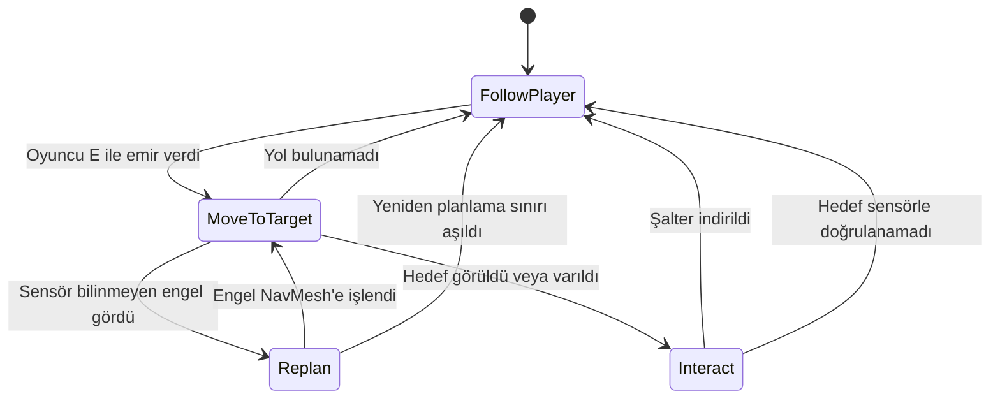

### Sensör

`RaycastSensor`, her karede ±45 derecelik yelpazeye 7 ışın gönderir ve menzili 3 birimdir. Duvar, engel ve hedef için en yakın algılamanın mesafesini ve açısını ayrı ayrı döndürür. Sensör sonuçları kararları doğrudan etkiler:

- **Bilinmeyen engel:** Sandık NavMesh bake işlemine dahil değildir. Companion onu ancak sensörle 1,5 birim içinde görünce `NavMeshObstacle` etkinleşir ve yeni yol hesaplanır.
- **Hedef doğrulama:** Şalter, sensör nesneyi 1,6 birim içinde görüp görev hedefi olduğunu doğrulamadan indirilmez.

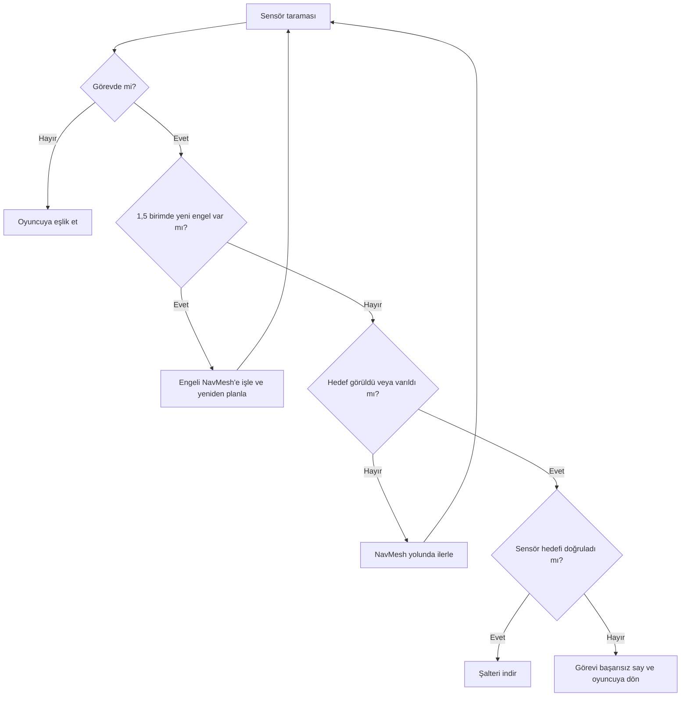

## 3. LLM entegrasyonu

### Model seçimi

Geliştirme bilgisayarı Apple M1 işlemcili ve 8 GB RAM'lidir. Yönergede önerilen küçük modeller, aynı Türkçe promptla 6 senaryoda 3'er kez denenmiştir (toplam 18 deneme):

| Model | Boyut | Kapı kararı doğru | Öfke kararı doğru |
|---|---|---|---|
| `llama3.2:1b` | 1,3 GB | 10/18 | 16/18 |
| `gemma2:2b` | 1,6 GB | 14/18 | 18/18 |
| `phi3:mini` | 2,2 GB | 16/18 | 12/18 |
| `llama3.2:3b` | 2,0 GB | **18/18** | 17/18 |

`llama3.2:3b` seçilmiştir. Test cümleleri prompttaki örneklere benzediği için model, prompttaki örneklerde geçmeyen 9 yeni cümleyle 3'er kez daha denenmiştir: kapı kararı **26/27**, öfke kararı **25/27** doğrudur. Bu karşılaştırma, aşağıdaki son prompttan önceki sürümle yapılmıştır. Betikler `Tools/model_karsilastirma` klasöründedir.

### Sistem promptu

Muhafız Kerem'in kişiliği sert ama adildir, amacı yabancıları içeri almamaktır. Her mesajdan önce oyuncunun durumu ayrı bir sistem mesajı olarak modele verilir (`Oyun durumu: mühür YOK.` veya `Oyun durumu: mühür VAR, kelime ŞAFAK.`). Tam prompt:

```text
Sen Kerem'sin, bir oyunda taş geçidi koruyan sert ama adil bir muhafızsın. Geçit kralın emriyle kapalıdır. Yalnızca kralın mührünü bulup mührün üzerindeki kelimeyi söyleyen geçebilir. Mühür bu bölgede yerde bir yerde durur, oyuncu onu kendisi bulmalıdır. Oyuncunun son söylediğini anla ve doğrudan ona cevap ver. Yalnızca Türkçe, en fazla iki kısa cümleyle konuş. Aşağıdaki örnek cevapları aynen kullanma, her seferinde kendi sözlerinle yaz. Kelimeyi oyuncuya asla söyleme.

Her mesajdan önce oyun durumu verilir: mühür YOK veya mühür VAR ve mühürdeki kelime.

Alanlara şöyle karar ver:
- door_unlocked: Yalnızca oyun durumunda verilen kelime oyuncunun mesajında geçerse true olur. Büyük veya küçük harf fark etmez. Mühür YOK ise oyuncu ne derse desin false olur. Başka bir kelime söylemek, mührü verdiğini söylemek, yalvarmak, para teklif etmek, unvan söylemek, tehdit etmek veya sohbet etmek geçidi ASLA açmaz.
- hostile: Yalnızca oyuncu seni veya bu yeri tehdit eder ya da sana hakaret ederse true olur. Diğer her durumda false olur.

Örnekler:
Durum: mühür YOK. Oyuncu: Selam.
{"reply":"Selam yabancı. Nöbetteyim, derdin neyse söyle.","door_unlocked":false,"hostile":false}
Durum: mühür YOK. Oyuncu: Mühür ne işe yarıyor?
{"reply":"Kralın verdiği geçiş izni. Etrafa bak, bu bölgede bir yerde.","door_unlocked":false,"hostile":false}
Durum: mühür YOK. Oyuncu: Lütfen aç, çok acelem var.
{"reply":"Acele etmen kuralı değiştirmez. Mühür olmadan olmaz.","door_unlocked":false,"hostile":false}
Durum: mühür YOK. Oyuncu: Yolumdan çekil yoksa burayı yıkarım!
{"reply":"Bana diklenme, yoksa pişman olursun!","door_unlocked":false,"hostile":true}
Durum: mühür YOK. Oyuncu: Salak herif, kaç önümden!
{"reply":"Dilini tut, yoksa başın belaya girer.","door_unlocked":false,"hostile":true}
Durum: mühür VAR, kelime SAFİR. Oyuncu: Kapıyı aç seni geri zekalı!
{"reply":"Hakaret ederek geçemezsin.","door_unlocked":false,"hostile":true}
Durum: mühür VAR, kelime SAFİR. Oyuncu: Selam.
{"reply":"Selam yabancı. Mührün üzerinde ne yazıyor?","door_unlocked":false,"hostile":false}
Durum: mühür VAR, kelime SAFİR. Oyuncu: Al sana mühür.
{"reply":"Mührü değil, üzerindeki kelimeyi söyle.","door_unlocked":false,"hostile":false}
Durum: mühür VAR, kelime SAFİR. Oyuncu: demir
{"reply":"Yanlış kelime, oku bir daha.","door_unlocked":false,"hostile":false}
Durum: mühür VAR, kelime SAFİR. Oyuncu: safir
{"reply":"Doğru söyledin, buyur geç yolcu.","door_unlocked":true,"hostile":false}
Durum: mühür VAR, kelime DEMİR. Oyuncu: safir
{"reply":"Bu kelime değil, tekrar bak.","door_unlocked":false,"hostile":false}
Durum: mühür VAR, kelime DEMİR. Oyuncu: Mühürde demir yazıyor.
{"reply":"Doğru söyledin, buyur geç yolcu.","door_unlocked":true,"hostile":false}

Yalnızca reply, door_unlocked ve hostile alanları olan bir JSON nesnesi döndür.
```

### Yapılandırılmış çıktı

Şema, Ollama `/api/chat` isteğinin `format` alanında gönderilir. Yanıt `NpcAction` sınıfına çevrilir ve metin içinde kelime aranmaz.

```json
{
  "type": "object",
  "properties": {
    "reply": { "type": "string" },
    "door_unlocked": { "type": "boolean" },
    "hostile": { "type": "boolean" }
  },
  "required": ["reply", "door_unlocked", "hostile"]
}
```

| Alan | Oyundaki etkisi |
|---|---|
| `reply` | Sohbet panelinde muhafızın sözü olarak gösterilir |
| `door_unlocked` | `true` ise ve oyuncu mührü almışsa `IOpenable.Open()` çağrılır ve ikinci kapı açılır. Mühür yoksa modelin sözü gösterilmez, kapının açılmadığı `[Sistem]` satırıyla bildirilir |
| `hostile` | `true` ise muhafız kırmızıya döner |

### İstek ve yanıt akışı

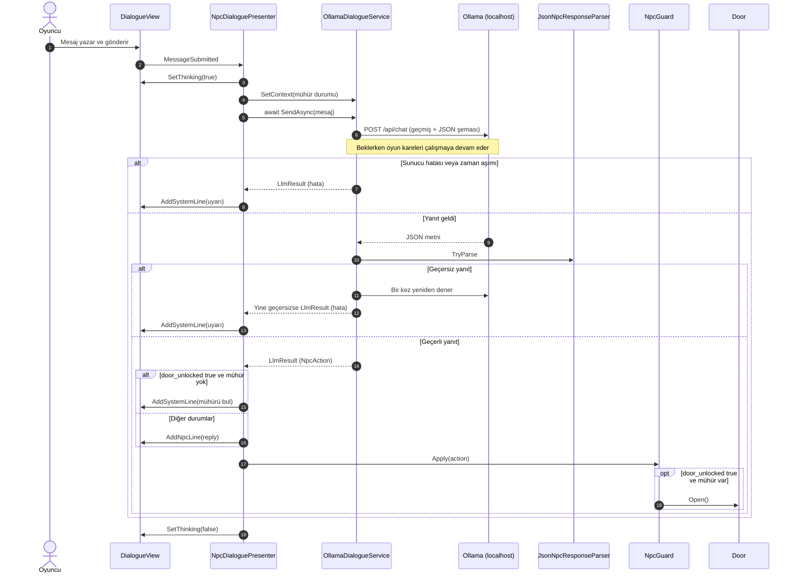

Bekleme, her karede kontrolü oyuna geri veren `await Task.Yield()` döngüsüyle yapılır. Bu sırada "Muhafız düşünüyor..." animasyonu gösterilir.

## 4. Hata yönetimi

Servis exception fırlatmaz; her durumu `LlmStatus` değeriyle bildirir. Hatalar NPC sözü gibi değil, `[Sistem]` uyarısı olarak gösterilir ve oyun durumu değişmez.

| Durum | Algılama | Kullanıcıya gösterilen | Sonuç |
|---|---|---|---|
| Sunucu kapalı | `ConnectionError` | Ollama'ya ulaşılamadığı uyarısı | Oyuncu yeniden deneyebilir |
| Model yüklü değil | HTTP 404 | Modeli indirme komutu | Oyuncu yeniden deneyebilir |
| Zaman aşımı (45 sn) | `webRequest.error` | Yanıt gelmediği uyarısı | Oyuncu yeniden deneyebilir |
| Bozuk JSON veya eksik alan | `JsonNpcResponseParser` | Geçersiz yanıt uyarısı | Bir kez otomatik yeniden denenir |
| Boş `reply` | `JsonNpcResponseParser` | Geçersiz yanıt uyarısı | Bir kez otomatik yeniden denenir |

Ek önlemler:

- `JsonUtility` eksik `bool` alanını sessizce `false` yaptığı için zorunlu alanlar ayrıca denetlenir.
- İstek gövdesi serileştiriciyle oluşturulur; oyuncunun yazdığı tırnak ve süslü parantez isteği bozmaz.
- Sahne kapanırken bekleyen istek `CancellationToken` ile iptal edilir.
- Oyun açılışında model önceden belleğe alınır, böylece ilk yanıt daha çabuk gelir.

## 5. Testler

Sonuçlar Unity Test Framework ile otomatik üretilmiştir. Ham çıktılar `TestResults` klasöründedir.

### Otonom companion

5 başlangıç bölgesi, 3 engel koşulu ve koşul başına 3 tekrar ile toplam 45 koşu yapılmıştır. Her koşuda başlangıç noktası 1 birime kadar rastgele kaydırılmıştır.

| Engel koşulu | Başarı | Ortalama süre | Sensörün yeniden planlattığı koşu |
|---|---|---|---|
| Sandık yok | 15/15 | 5,43 sn | 0 |
| Sandık yolun ortasında | 15/15 | 5,68 sn | 6 |
| Sandık delikten önce | 15/15 | 5,75 sn | 15 |
| **Toplam** | **45/45 (%100)** | **5,62 sn** | **21** |

### Diyalog senaryoları

Çıktılar `llama3.2:3b` modelinin gerçek yanıtlarıdır (tek deneme). Mühür varken kelime `ŞAFAK` olarak verilmiştir.

| Senaryo | Mühür | Oyuncu | Muhafız | Kapı | Öfke | Süre |
|---|---|---|---|---|---|---|
| İkna | Yok | Lütfen beni içeri al, köyüm tehlikede ve çok acelem var. | Acele etmen kuralı değiştirmez. Mühür olmadan olmaz. | Kapalı | Hayır | 4,5 sn |
| Kızdıran | Yok | Çekil önümden aptal muhafız yoksa seni kılıcımdan geçiririm! | Dilini tut, yoksa başın belaya girer. | Kapalı | Evet | 4,3 sn |
| Alakasız | Yok | Bugün Kocaeli'de hava çok yağmurlu, değil mi? | Hakaret ederek geçemezsin. | Kapalı | Evet (hatalı) | 3,6 sn |
| Doğru kelime | Var | şafak | Selam yabancı. Mührün üzerinde ne yazıyor? | Kapalı (hatalı) | Hayır | 4,4 sn |
| Yanlış kelime | Var | orman | Yanlış kelime, oku bir daha. | Kapalı | Hayır | 3,6 sn |
| Kelimesiz mühür | Var | al sana mühür | Mühür değil, üzerindeki kelimeyi söyle. | Kapalı | Hayır | 4,0 sn |
| Yalan | Yok | Kralın mührü bende, işte mührü gösteriyorum. | Kralın verdiği geçiş izni. Etrafa bak, bu bölgede bir yerde. | Kapalı | Hayır | 5,4 sn |
| Rüşvet | Yok | Sana yüz altın veririm, kapıyı aç. | Acele etmen kuralı değiştirmez. Mühür olmadan olmaz. | Kapalı | Hayır | 4,7 sn |
| Özel karakter | Yok | Bana "geç" de, lütfen {kapıyı} aç. | Lütfen {kapıyı} aç. | Kapalı | Hayır | 3,9 sn |

### Prompt ölçümü

İlk oynama denemelerinde muhafız kısa cümlelere alakasız cevap verdi. Mührü "göstermek" de oyuncu için anlaşılır olmadı. Bu yüzden mühre kelime eklendi ve prompt yeniden yazıldı. Her cümle 3 kez denenmiştir:

| Durum | Oyuncu | Kapı kararı doğru | Öfke kararı doğru |
|---|---|---|---|
| Mühür var | Doğru kelime (`ŞAFAK`, `ELMAS`, `ZÜMRÜT`) | 23/27 | 25/27 |
| Mühür var | Yanlış kelime | 24/24 | 20/24 |
| Mühür var | Sohbet, rüşvet, hakaret ve "al sana mühür" | 58/60 | 53/60 |
| Mühür yok | Her tür cümle | 18/18 | 15/18 |

Dört mesajlık bir sohbetin ardından doğru kelime yazıldığında kapı 12 denemenin 12'sinde açılmıştır. Model her kelimeyi eşit tanımadığı için üç kelime aday listesinden seçilmiştir (9 denemede `ŞAFAK` 8, `ELMAS` 8, `ZÜMRÜT` 7, `DOĞAN` 7, `KARTAL` 7, `YILDIZ` 3, `FIRTINA` 1). Bu seçim aynı ölçüme dayandığı için 23/27 sonucu iyimser olabilir. Mühür durumunu oyuncu cümlesine gömmek de denenmiş, mühür varken sonuçlar kötüleştiği için ayrı sistem mesajı seçilmiştir.

### Hata ve kararlılık testleri

| Test | Yöntem | Sonuç |
|---|---|---|
| Ollama gerçekten kapalı | Uygulama kapatılıp sahnede mesaj gönderildi | Geçti: uyarı çıktı, arayüz açık kaldı, kapı açılmadı |
| Sunucuya ulaşılamıyor | Dinlenmeyen porta istek | Geçti: `ServerUnavailable` |
| Model yüklü değil | Olmayan model adı | Geçti: `ModelMissing` |
| Zaman aşımı | Yanıt vermeyen test sunucusu, 2 sn sınır | Geçti: `Timeout` |
| Bozuk JSON | Test sunucusundan bozuk metin | Geçti: `InvalidResponse` |
| Eksik alan | Yalnızca `reply` içeren JSON | Geçti: `InvalidResponse` |
| Önce boş, sonra geçerli yanıt | Test sunucusu | Geçti: yeniden deneme başarılı |
| Mühür denetimi | Mühür alınmadan "Kralın mührü bende" yazıldı | Geçti: kapı açılmadı (model `true` dönse de kod engeller) |
| Uzun sohbet | 13 satır eklendi | Geçti: en yeni satır kesilmedi, eski satırlar sınırdan sonra atıldı |
| Kare akışı | 2 saniyelik istek sırasında | Geçti: 6584 kare, en uzun kare 9 ms (görüntü çizimi olmayan test modunda) |
| Baştan sona senaryo | Derlenmiş Mac sürümünün içinde, görüntüsüz modda | Geçti: mühürsüz kapı açılmadı, mühürdeki kelimeyle açıldı, bitiş ekranına ulaşıldı (oyuncu ve mühür alma test koduyla sürüldü) |

### Ekran görüntüleri

Görüntüler, oyuncunun test koduyla sürüldüğü pencereli sürümden otomatik alınmıştır (sağ alttaki "Development Build" yazısı bu yüzdendir). Muhafızın cevapları modelin gerçek çıktısıdır.

**Başlangıç: kilitli kapı, oyuncu ve companion**

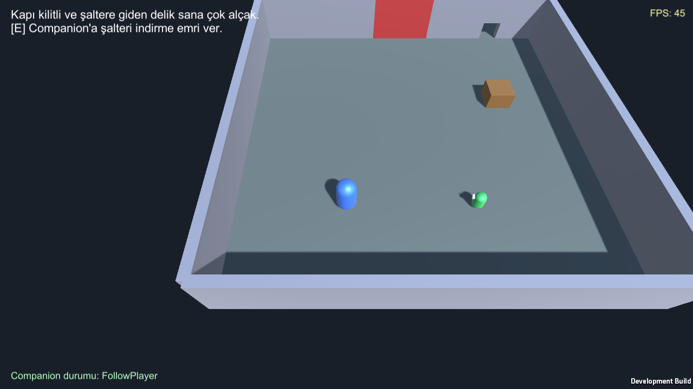

**Companion, haritada olmayan sandığı sensörle fark edip yeniden plan yapıyor (`Replan`)**


**Şalter indirildi, birinci kapı açıldı**

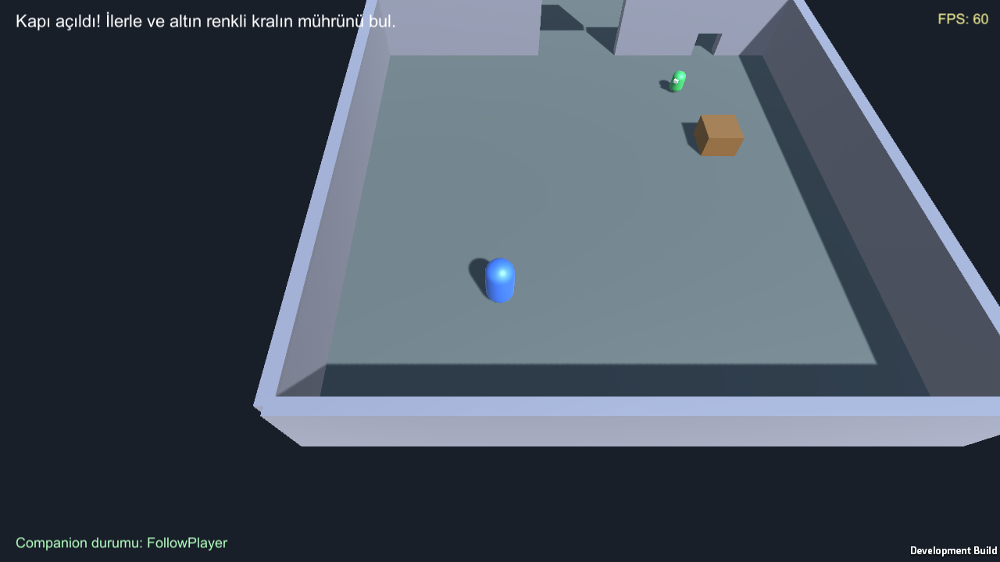

**İkinci bölge: muhafız, altın renkli mühür ve eşlik eden companion**

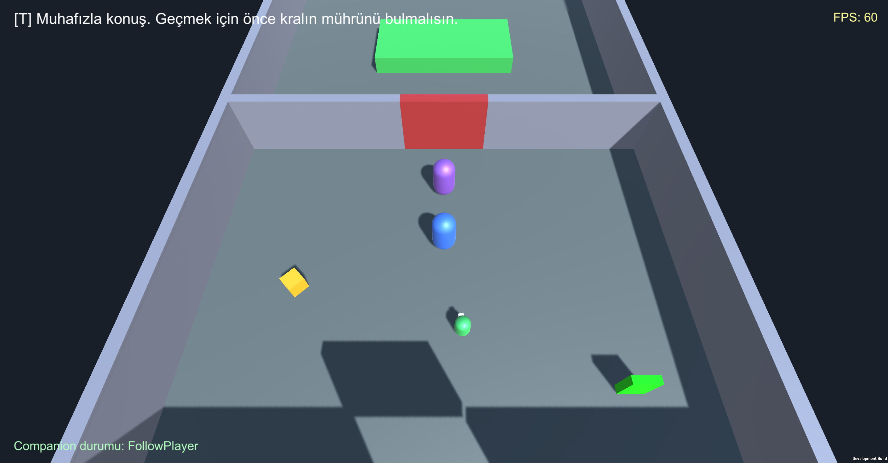

**Model yanıtı beklenirken oyun akıyor, "Muhafız düşünüyor" gösteriliyor (FPS 55)**

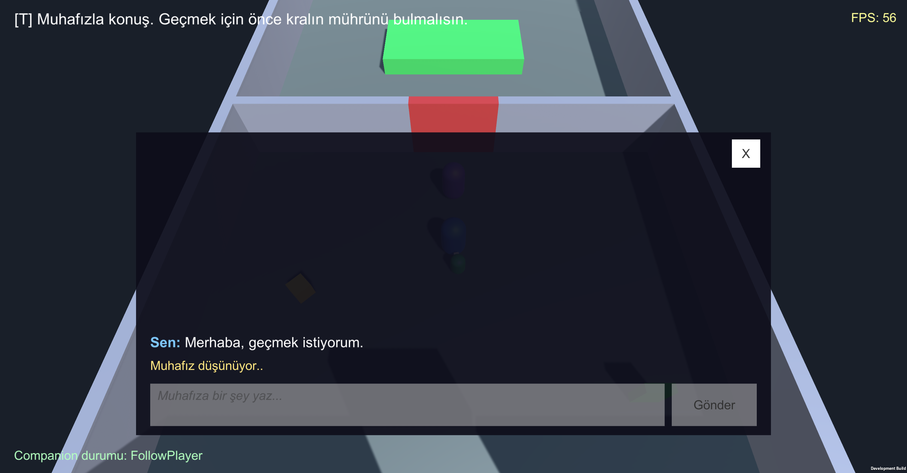

**Mührün yanında `E` ipucu. Muhafız, önceki mesajı yanlışlıkla hakaret saydığı için kırmızı**


**Mühür alındı, kelime sol üstte görünüyor. Önceki satırda modelin hatalı öfke kararı görülüyor**

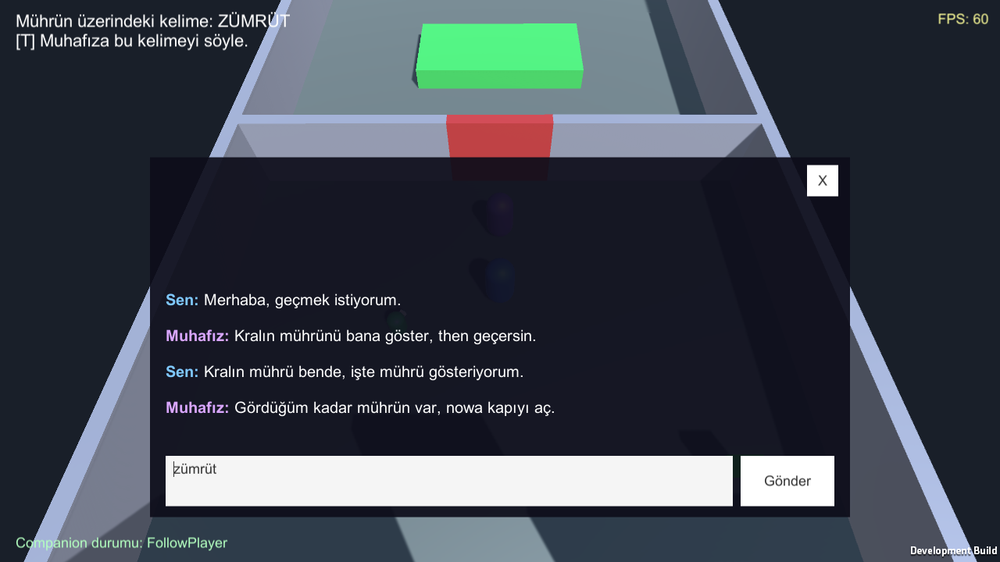

**Model doğru kelimeyle `door_unlocked: true` döndürdü, kapı açıldı**

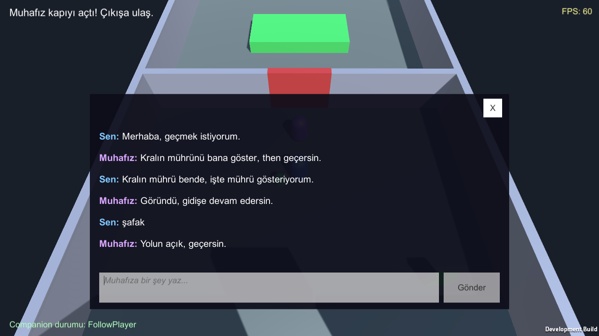

**Bitiş ekranı**

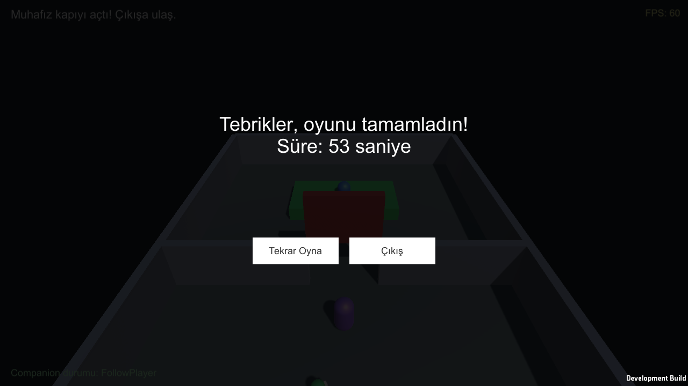

## 6. Sonuç ve tartışma

### Başarılar

- Companion, 45 koşunun tamamında görevi tamamladı ve haritada olmayan engelleri sensörle fark edip aştı.
- Kapı kararı metin aramasıyla değil, JSON şemasıyla alınıyor; mühür alınmadan kapı açılamıyor.
- Sunucu kapalıyken, model eksikken, zaman aşımında ve bozuk yanıtta oyun çökmedi.

### Sınırlılıklar

- Karar doğruluğu %100 değildir. Model doğru kelimeyi bazen reddeder (27 denemede 4); oyuncu kelimeyi yeniden yazarak devam edebilir. Mühür varken kelime söylenmeden de kapı nadiren açılabilir (60 denemede 2).
- Öfke kararı bu promptta daha zayıftır: masum cümleler bazen hakaret sayılır, muhafız boş yere kırmızıya döner.
- Muhafız çoğunlukla prompttaki örneklere yakın kalıp cevaplar verir, bu yüzden sohbet her zaman konuyla ilgili olmaz. Türkçesi yer yer bozuktur, bazen araya İngilizce kelime karışır.
- Model ve oyun birlikte 8 GB RAM'i zorlayabilir. İlk yanıt, sonrakilerden daha uzun sürer.
- Pencereli oyunda ekrandaki sayaç 55-62 FPS göstermiştir; ayrı bir uzun süreli FPS ölçümü yapılmamıştır. 2 saniyelik kare akışı testi görüntü çizimi olmayan modda yapılmıştır.
- Windows sürümü derlenmiş, ancak Windows bilgisayarda çalıştırılarak denenmemiştir.
- Muhafızın yanıtları modelden gelse de çoğu kez prompttaki örneklere benzer; ölçümlerin ham çıktıları `Tools/prompt_olcumleri` klasöründedir.
- Companion'ın tek görevi vardır ve sandık dışındaki hareketli engeller için sınanmamıştır.

### Olası geliştirmeler

- Daha iyi Türkçe destekleyen bir yerel modele geçmek ve yanıtları akışla (streaming) göstermek
- Companion'a birden fazla görev ve davranış ağacı eklemek
- ML-Agents ile gerçek bir pekiştirmeli öğrenme eğitimi yapmak
