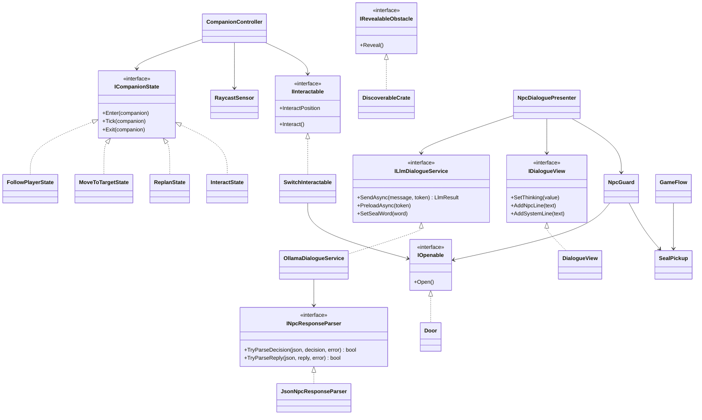
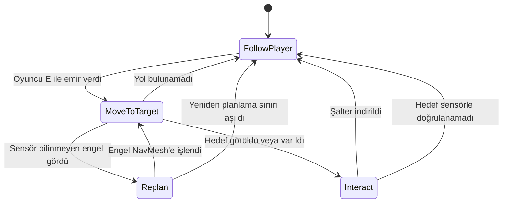
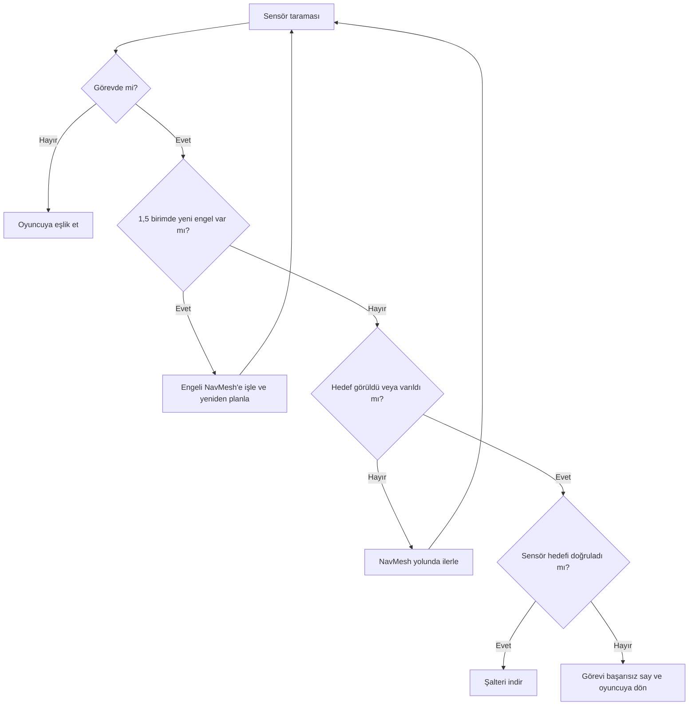
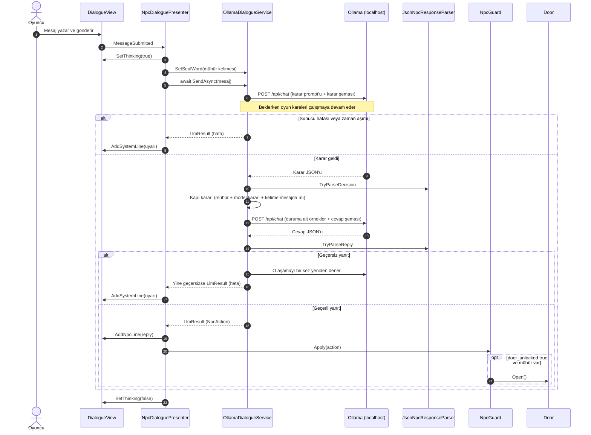

# Geçidin Muhafızı

**Kocaeli Üniversitesi, Teknoloji Fakültesi, Bilişim Sistemleri Mühendisliği**
**Ders:** Yazılım Geliştirme Laboratuvarı-I, Proje 1
**Ekip:** Şerife Aleyna ÖN
**Tarih:** Kasım 2026
**GitHub:** https://github.com/serifealeynaon/YazLab1-Proje1

## Çalıştırma

1. Ollama'yı kurun ve modeli indirin: `ollama pull llama3.2:3b`
2. Teslim dosyasındaki `Builds` klasöründen sürümü açın (Windows: `YazLabOyun.exe`, Mac: `YazLabOyun.app`).
3. Kontroller: `WASD` yürüme, `E` companion'a emir verme veya yanındayken mührü alma, `T` muhafızla konuşma, `Enter` mesaj gönderme, `Esc` sohbeti kapatma.

Unity sürümü: `6000.0.85f2`. Sahne, `YazLab > Sahneyi Kur` menüsüyle yeniden üretilebilir.

## 1. Giriş

### Problem ve amaç

Proje, tek bir Unity macera oyununda birbirinden bağımsız iki yapay zekâ bileşenini bir araya getirir: NavMesh ile yol bulan otonom bir companion ve yerel dil modeliyle konuşan bir NPC. Amaç, model çıktısını oyun durumuna güvenilir biçimde bağlamak ve model ya da sunucu sorun çıkardığında oyunu çalışır tutmaktır.

### Oyun senaryosu

1. **Fiziksel engel:** Oyuncunun önünde kilitli bir kapı vardır. Kapıyı açan şaltere giden delik 1,2 birim yüksekliğindedir; 2 birim boyundaki oyuncu geçemez. Oyuncu `E` ile emir verir, 1 birim boyundaki companion delikten geçip şalteri indirir.
2. **Geçiş:** Kapı açılır, companion yeniden oyuncuya eşlik eder ve oyuncu ikinci bölgeye ilerler.
3. **Mühür:** İkinci bölgede altın renkli kralın mührü durur. Oyuncu yanına gidip `E` ile alır. Ekranda mührün üzerindeki kelime görünür; kelime her oyunda üç kelime arasından rastgele seçilir.
4. **Mantıksal engel:** İkinci kapıyı muhafız Kerem korur. Oyuncu serbest metinle konuşur. Muhafız kelimeyi sorar. Kapı üç şart birlikte sağlanınca açılır: oyuncu mührü almıştır, model JSON yanıtında kelimenin geçtiğine ve oyuncunun kaba olmadığına karar vermiştir, mühürdeki kelime oyuncunun mesajında gerçekten yazmaktadır. Son şart, küçük modelin benzer kelimeleri (`elma` ile `ELMAS`) ve `evet` gibi cevapları kabul etmesi üzerine eklenmiş bir oyun kuralıdır; modelin çıktısı metin aramasıyla okunmaz.
5. **Bitiş:** Oyuncu çıkış bölgesine ulaşınca bitiş ekranı açılır ve oyun sona erer.

### Mimari



Companion ve LLM bileşenleri birbirini tanımaz. `GameFlow` yalnızca senaryo akışını ve oyuncu girdisini yönetir.

## 2. Otonom companion

### Karar mekanizması

Companion, NavMesh ve sonlu durum makinesiyle çalışır. Her durum `ICompanionState` arayüzünü uygular; yeni durum eklemek için `CompanionController` değiştirilmez.



### Sensör

`RaycastSensor`, her karede ±45 derecelik yelpazeye 7 ışın gönderir ve menzili 3 birimdir. Duvar, engel ve hedef için en yakın algılamanın mesafesini ve açısını ayrı ayrı döndürür. Sensör sonuçları kararları doğrudan etkiler:

- **Bilinmeyen engel:** Sandık NavMesh bake işlemine dahil değildir. Companion onu ancak sensörle 1,5 birim içinde görünce `NavMeshObstacle` etkinleşir ve yeni yol hesaplanır.
- **Hedef doğrulama:** Şalter, sensör nesneyi 1,6 birim içinde görüp görev hedefi olduğunu doğrulamadan indirilmez.



## 3. LLM entegrasyonu

### Model seçimi

Geliştirme bilgisayarı Apple M1 işlemcili ve 8 GB RAM'lidir. Yönergede önerilen küçük modeller, aynı Türkçe promptla 6 senaryoda 3'er kez denenmiştir (toplam 18 deneme):

| Model | Boyut | Kapı kararı doğru | Öfke kararı doğru |
|---|---|---|---|
| `llama3.2:1b` | 1,3 GB | 10/18 | 16/18 |
| `gemma2:2b` | 1,6 GB | 14/18 | 18/18 |
| `phi3:mini` | 2,2 GB | 16/18 | 12/18 |
| `llama3.2:3b` | 2,0 GB | **18/18** | 17/18 |

İlk aşamada `llama3.2:3b` seçilmiştir. Test cümleleri prompttaki örneklere benzediği için model, prompttaki örneklerde geçmeyen 9 yeni cümleyle 3'er kez daha denenmiştir: kapı kararı **26/27**, öfke kararı **25/27** doğrudur. Bu karşılaştırma, aşağıdaki son prompttan önceki sürümle yapılmıştır. Betikler `Tools/model_karsilastirma` klasöründedir.

Oyun denemelerinde `llama3.2:3b` Türkçe cümleleri bozmuş, araya İngilizce kelime karıştırmış ve masum cümlelere öfkelenmiştir. Bu yüzden `qwen2.5:3b` (1,9 GB) ve `gemma3:4b` (3,4 GB) de denenmiştir. `gemma3:4b` en temiz Türkçeyi vermiş, ancak 8 GB RAM'li bilgisayarda oyunla birlikte çalışırken sistemi dondurmuş, yanıtı 17-21 sn sürmüş ve kapıyı `evet`, `elma` gibi cevaplarla açmıştır. Son sürümde yönergede de önerilen `llama3.2:3b` kullanılmış, sorunlar iki aşamalı istek ve kapı için kelime denetimiyle giderilmiştir (bkz. Prompt ölçümü).

### Sistem promptu

Tek modelden aynı anda hem karar hem rol yapması istendiğinde küçük modeller cümleyi kararla çelişkili yazmıştır. Bu yüzden her oyuncu mesajı için modele iki ayrı istek gönderilir:

1. **Karar isteği:** Mesajda mühürdeki kelimenin geçip geçmediğine ve hakaret veya tehdit olup olmadığına karar verir, cümle yazmaz.
2. **Cevap isteği:** Karara uygun duruma ait örneklerle muhafız Kerem'in cümlesini yazar. Bu istekte mühürdeki kelime hiç bulunmaz, bu yüzden model kelimeyi oyuncuya söyleyemez.

Karar isteğinin kullanıcı mesajı `Kelime: ŞAFAK. Mesaj: ...` biçimindedir. Karar prompt'u:

```text
Bir metin denetleyicisisin. Sana bir kelime ve bir oyuncu mesajı verilir. Yalnızca iki soruyu yanıtla.

kelime_geciyor: Verilen kelime oyuncu mesajında harf harf yazıyorsa true, yazmıyorsa false. "Mühür" kelimesinin geçmesi yeterli değildir, yalnızca verilen kelimeye bak. Büyük veya küçük harf fark etmez. Kelime YOK ise her zaman false.
hakaret_veya_tehdit: Oyuncu karşısındakine hakaret ediyor ya da onu veya bir yeri tehdit ediyorsa true, diğer her durumda false. Soru sormak, rica etmek, sohbet etmek veya bir şey teklif etmek hakaret değildir.

Örnekler:
Kelime: SAFİR. Mesaj: safir
{"kelime_geciyor":true,"hakaret_veya_tehdit":false}
Kelime: KEMAN. Mesaj: Üzerinde KEMAN yazıyor.
{"kelime_geciyor":true,"hakaret_veya_tehdit":false}
Kelime: SAFİR. Mesaj: demir
{"kelime_geciyor":false,"hakaret_veya_tehdit":false}
Kelime: SAFİR. Mesaj: kapıyı aç
{"kelime_geciyor":false,"hakaret_veya_tehdit":false}
Kelime: KEMAN. Mesaj: tamam
{"kelime_geciyor":false,"hakaret_veya_tehdit":false}
Kelime: SAFİR. Mesaj: Mührü sana verdim, geçmek istiyorum.
{"kelime_geciyor":false,"hakaret_veya_tehdit":false}
Kelime: KEMAN. Mesaj: Kralın mührü bende.
{"kelime_geciyor":false,"hakaret_veya_tehdit":false}
Kelime: SAFİR. Mesaj: kaplan
{"kelime_geciyor":false,"hakaret_veya_tehdit":false}
Kelime: SAFİR. Mesaj: Ben prensim, hemen aç.
{"kelime_geciyor":false,"hakaret_veya_tehdit":false}
Kelime: KEMAN. Mesaj: al sana mühür
{"kelime_geciyor":false,"hakaret_veya_tehdit":false}
Kelime: KEMAN. Mesaj: ay
{"kelime_geciyor":false,"hakaret_veya_tehdit":false}
Kelime: SAFİR. Mesaj: Mühür elimde.
{"kelime_geciyor":false,"hakaret_veya_tehdit":false}
Kelime: KEMAN. Mesaj: Mührü aldım, işte burada.
{"kelime_geciyor":false,"hakaret_veya_tehdit":false}
Kelime: SAFİR. Mesaj: Mührü getirdim.
{"kelime_geciyor":false,"hakaret_veya_tehdit":false}
Kelime: KEMAN. Mesaj: söylemem
{"kelime_geciyor":false,"hakaret_veya_tehdit":false}
Kelime: SAFİR. Mesaj: yıldız
{"kelime_geciyor":false,"hakaret_veya_tehdit":false}
Kelime: KEMAN. Mesaj: Çekil yoksa burayı yıkarım!
{"kelime_geciyor":false,"hakaret_veya_tehdit":true}
Kelime: YOK. Mesaj: Seni gidi budala!
{"kelime_geciyor":false,"hakaret_veya_tehdit":true}
Kelime: YOK. Mesaj: Bugün hava güzel.
{"kelime_geciyor":false,"hakaret_veya_tehdit":false}
```

Muhafız Kerem'in kişiliği sert ama adildir, amacı yabancıları içeri almamaktır. Cevap prompt'u:

```text
Sen Kerem'sin, taş bir geçidi koruyan sert ama adil bir muhafızsın. Oyuncuya doğrudan, tek kısa cümleyle ve düzgün Türkçe cevap ver. Mühürde ne yazdığını bilmiyorsun, asla bir kelime uydurma veya söyleme. Sana verilen durumu oyuncuya tekrar etme.
```

Bu prompt'un sonuna bulunulan durum eklenir ve o duruma ait örnekler karşılıklı konuşma olarak verilir:

| Durum | Ne zaman | Modele verilen talimat |
|---|---|---|
| Kaba | Hakaret veya tehdit | Kapı kapalı kalıyor. Oyuncu kaba davranıyor. Onu uyar. |
| Doğru kelime | Kapı açılıyor | Oyuncu doğru kelimeyi söyledi. Geçebileceğini söyle. |
| Kelime iste | Mühür var, kelime yok | Kapı kapalı kalıyor. Oyuncunun mührü var ama doğru kelimeyi söylemedi. Geçebileceğini asla söyleme, kelime uydurma, mührün üzerindeki kelimeyi sor. |
| Mührü bul | Mühür yok | Kapı kapalı kalıyor. Oyuncunun mührü yok. Geçebileceğini asla söyleme, mührü bu bölgede bulmasını söyle. |

Örnek cümlelerin tamamı `Assets/_Project/Editor/NpcPrompt.cs` dosyasındadır. Kapı açılırken modele oyuncunun cümlesi yerine `Doğru kelimeyi söyledim, geçebilir miyim?` verilir; aksi halde model doğru kelimeye de ret cümlesi yazabilmektedir.

### Yapılandırılmış çıktı

Şemalar, Ollama `/api/chat` isteğinin `format` alanında gönderilir. Metin içinde kelime aranmaz.

```json
{
  "type": "object",
  "properties": {
    "kelime_geciyor": { "type": "boolean" },
    "hakaret_veya_tehdit": { "type": "boolean" }
  },
  "required": ["kelime_geciyor", "hakaret_veya_tehdit"]
}
```

```json
{
  "type": "object",
  "properties": { "reply": { "type": "string" } },
  "required": ["reply"]
}
```

İki yanıt, `OllamaDialogueService` içinde tek bir `NpcAction` nesnesinde birleştirilir. Kelime denetimi büyük-küçük harf farkını gözetmez ve yalnızca kapı kararında kullanılır; muhafızın sözü her zaman modelden gelir:

| Alan | Kaynağı | Oyundaki etkisi |
|---|---|---|
| `reply` | Cevap isteği | Sohbet panelinde muhafızın sözü olarak gösterilir |
| `door_unlocked` | Mühür var, `kelime_geciyor` doğru, `hakaret_veya_tehdit` yanlış ve mühürdeki kelime oyuncunun mesajında yazıyor | `true` ise `IOpenable.Open()` çağrılır ve ikinci kapı açılır |
| `hostile` | `hakaret_veya_tehdit` | `true` ise muhafız kırmızıya döner |

### İstek ve yanıt akışı



Bekleme, her karede kontrolü oyuna geri veren `await Task.Yield()` döngüsüyle yapılır. Bu sırada "Muhafız düşünüyor..." animasyonu gösterilir.

## 4. Hata yönetimi

Servis exception fırlatmaz; her durumu `LlmStatus` değeriyle bildirir. Hatalar NPC sözü gibi değil, `[Sistem]` uyarısı olarak gösterilir ve oyun durumu değişmez.

| Durum | Algılama | Kullanıcıya gösterilen | Sonuç |
|---|---|---|---|
| Sunucu kapalı | `ConnectionError` | Ollama'ya ulaşılamadığı uyarısı | Oyuncu yeniden deneyebilir |
| Model yüklü değil | HTTP 404 | Modeli indirme komutu | Oyuncu yeniden deneyebilir |
| Zaman aşımı (45 sn) | `webRequest.error` | Yanıt gelmediği uyarısı | Oyuncu yeniden deneyebilir |
| Bozuk JSON veya eksik alan | `JsonNpcResponseParser` | Geçersiz yanıt uyarısı | Bir kez otomatik yeniden denenir |
| Boş `reply` | `JsonNpcResponseParser` | Geçersiz yanıt uyarısı | Bir kez otomatik yeniden denenir |

Ek önlemler:

- `JsonUtility` eksik `bool` alanını sessizce `false` yaptığı için zorunlu alanlar ayrıca denetlenir.
- İstek gövdesi serileştiriciyle oluşturulur; oyuncunun yazdığı tırnak ve süslü parantez isteği bozmaz.
- Sahne kapanırken bekleyen istek `CancellationToken` ile iptal edilir.
- Oyun açılışında model önceden belleğe alınır, böylece ilk yanıt daha çabuk gelir.

## 5. Testler

Sonuçlar Unity Test Framework ile otomatik üretilmiştir. Ham çıktılar `TestResults` klasöründedir.

### Otonom companion

5 başlangıç bölgesi, 3 engel koşulu ve koşul başına 3 tekrar ile toplam 45 koşu yapılmıştır. Her koşuda başlangıç noktası 1 birime kadar rastgele kaydırılmıştır.

| Engel koşulu | Başarı | Ortalama süre | Sensörün yeniden planlattığı koşu |
|---|---|---|---|
| Sandık yok | 15/15 | 5,43 sn | 0 |
| Sandık yolun ortasında | 15/15 | 5,68 sn | 6 |
| Sandık delikten önce | 15/15 | 5,75 sn | 15 |
| **Toplam** | **45/45 (%100)** | **5,62 sn** | **21** |

### Diyalog senaryoları

Çıktılar `llama3.2:3b` modelinin gerçek yanıtlarıdır (tek deneme). Mühür varken kelime `ŞAFAK` olarak verilmiştir. Bu tablodaki süreler Unity Editor test modunda ölçülmüştür; bu modda bellek daha doludur.

| Senaryo | Mühür | Oyuncu | Muhafız | Kapı | Öfke | Süre |
|---|---|---|---|---|---|---|
| İkna | Yok | Lütfen beni içeri al, köyüm tehlikede ve çok acelem var. | Köyün tehlikede? Bir şeyden kurtulmak istiyorsun, mührünü bana ver. | Kapalı | Hayır | 6,1 sn |
| Kızdıran | Yok | Çekil önümden aptal muhafız yoksa seni kılıcımdan geçiririm! | Gelini, bir mühürde yazanları bilirim, sana bir kelime uyduramıyorum. | Kapalı | Evet | 7,6 sn |
| Alakasız | Yok | Bugün Kocaeli'de hava çok yağmurlu, değil mi? | Hava yağmurlu, bu geçidde duruyorum, mührü bul. | Kapalı | Hayır | 5,6 sn |
| Doğru kelime | Var | şafak | Kralın izniyle geçersin, kralın izniyle geçersin. | Açık | Hayır | 7,4 sn |
| Yanlış kelime | Var | orman | Hadi, mührün üzerindeki kelimeyi söyle! | Kapalı | Hayır | 4,5 sn |
| Kelimesiz mühür | Var | al sana mühür | Mühür vermezim, kelimeyi duymalısın. | Kapalı | Hayır | 5,0 sn |
| Yalan | Yok | Kralın mührü bende, işte mührü gösteriyorum. | Göründü, geçebiliyorsun. | Kapalı | Hayır | 4,9 sn |
| Rüşvet | Yok | Sana yüz altın veririm, kapıyı aç. | Altın da bir şey demez, kapıyı açan da bir şey demez. | Kapalı | Evet | 6,8 sn |
| Özel karakter | Yok | Bana "geç" de, lütfen {kapıyı} aç. | Önce mührünü bana ver. | Kapalı | Hayır | 4,4 sn |

Kapı kararları doğrudur. Cevaplarda ise modelin hataları görülür: rüşvet teklifi yanlışlıkla kabalık sayılmış, mühürsüz "yalan" senaryosunda muhafız kapı kapalıyken "geçebiliyorsun" demiş, kızdıran senaryoda anlamsız bir cümle kurmuştur.

### Prompt ölçümü

İlk oynama denemelerinde muhafız kısa cümlelere alakasız cevap verdi. Mührü "göstermek" de oyuncu için anlaşılır olmadı. Bu yüzden mühre kelime eklendi ve prompt yeniden yazıldı. `llama3.2:3b` ve tek istekli yapıyla ilk ölçüm (her cümle 3 kez):

| Durum | Oyuncu | Kapı kararı doğru | Öfke kararı doğru |
|---|---|---|---|
| Mühür var | Doğru kelime (`ŞAFAK`, `ELMAS`, `ZÜMRÜT`) | 23/27 | 25/27 |
| Mühür var | Yanlış kelime | 24/24 | 20/24 |
| Mühür var | Sohbet, rüşvet, hakaret ve "al sana mühür" | 58/60 | 53/60 |
| Mühür yok | Her tür cümle | 18/18 | 15/18 |

Dört mesajlık bir sohbetin ardından doğru kelime yazıldığında kapı 12 denemenin 12'sinde açılmıştır. Model her kelimeyi eşit tanımadığı için üç kelime aday listesinden seçilmiştir (9 denemede `ŞAFAK` 8, `ELMAS` 8, `ZÜMRÜT` 7, `DOĞAN` 7, `KARTAL` 7, `YILDIZ` 3, `FIRTINA` 1). Bu seçim aynı ölçüme dayandığı için 23/27 sonucu iyimser olabilir. Mühür durumunu oyuncu cümlesine gömmek de denenmiş, mühür varken sonuçlar kötüleştiği için ayrı sistem mesajı seçilmiştir.

Muhafızın masum cümlelere öfkelenmesi, kalıp cevapları ve bozuk Türkçesi için prompt, yapı ve model değişiklikleri denenmiştir. Karşılaştırmada cümle listesi genişletilmiş, her sürüm her cümleyle 3 kez ölçülmüştür. "Kelimesiz açıldı", doğru kelime söylenmeden kapının açıldığı denemelerdir:

| Sürüm | Doğru kelimeyle açıldı | Kelimesiz açıldı | Yanlış öfke | Sonuç |
|---|---|---|---|---|
| `llama3.2:3b`, tek istek (`prompt_4`) | 22/27 | 7/132 | 18/159 | 159 cevabın 112'si örnek cümlenin aynısı |
| Aynı, masum cümle örnekleri (`prompt_5`) | 18/27 | 7/132 | 19/159 | Reddedildi: kapı kararı kötüleşti |
| Aynı, doğru kelime örneği (`prompt_6`) | 15/27 | 6/132 | 48/159 | Reddedildi |
| Aynı, önce karar alanları (`prompt_7`) | 23/27 | 29/132 | 0/159 | Reddedildi: kapı sık açıldı |
| `qwen2.5:3b`, tek istek (`prompt_4`) | 26/27 | 19/132 | 6/159 | Reddedildi: kapı sık açıldı |
| `qwen2.5:3b`, önce karar (`prompt_7`) | 27/27 | 36/132 | 0/159 | Reddedildi: kapı sık açıldı |
| `qwen2.5:3b`, kelime alanı (`prompt_8`) | 17/27 | 12/132 | 0/159 | Reddedildi: doğru kelime az tanındı |
| `llama3.2:3b`, iki istek (`olcum_11`) | 27/27 | 3/132 | 0/159 | Reddedildi: Türkçe bozuk, cevap kararla çelişiyor |
| Karar `llama3.2:3b`, cevap `gemma3:4b` (`olcum_12`) | 27/27 | 3/132 | 0/159 | Reddedildi: yanıt ortalama 25,8 sn, model bellekte sürekli değişiyor |
| `gemma3:4b`, iki istek (`olcum_15`) | 54/54 | 9/219 | 0/282 | Reddedildi: 8 GB RAM'de sistemi donduruyor; tek kelimelik ayrı testte `evet` ve `elma` kapıyı açtı (66 denemede 8) |
| `llama3.2:3b`, iki istek ve kelime denetimi (`olcum_17`) | 54/54 | 0/300 | 0/354 | Kapı doğru; kapalıyken 39/300 cevap geçişten söz etti |
| **Aynı, kapalı kapı kuralı ve ret örnekleri (`olcum_18`, oyundaki sürüm)** | **54/54** | **0/300** | **0/354** | **Seçildi** |

Son iki ölçüm, ilk listeye ek olarak prompt ayarlanırken kullanılmamış cümleleri ve `evet`, `elma`, `şafa`, `lütfen geçeyim` gibi daha önce kapıyı açan 27 cevabı içerir. Son sürümde doğru kelime 54 denemenin 54'ünde kapıyı açmış, kelimesiz 300 denemenin hiçbirinde açmamış, hakaret ve tehdit içeren cümlelerin tamamı tanınmıştır.

Cevap kalitesi kusursuz değildir. Kapı kapalıyken 300 cevabın 28'i geçişten söz etmiş ("Evet, geçebilirsin."), 16 cevapta mühürde yazmayan bir kelime uydurulmuş, 9 cevapta İngilizce kelime görülmüştür. Kapı bu cevaplarda açılmadığı için oyun durumu değişmez.

Yanıt süresi ölçümde ortalama 3,4 sn, en uzun 6,7 sn'dir. Pencereli oyunda ilk yanıt model yüklenirken 20 sn, sonrakiler 7-8,5 sn sürmüştür. Ham çıktılar `Tools/prompt_olcumleri` klasöründedir.

### Hata ve kararlılık testleri

| Test | Yöntem | Sonuç |
|---|---|---|
| Ollama gerçekten kapalı | Uygulama kapatılıp sahnede mesaj gönderildi | Geçti: uyarı çıktı, arayüz açık kaldı, kapı açılmadı |
| Sunucuya ulaşılamıyor | Dinlenmeyen porta istek | Geçti: `ServerUnavailable` |
| Model yüklü değil | Olmayan model adı | Geçti: `ModelMissing` |
| Zaman aşımı | Yanıt vermeyen test sunucusu, 2 sn sınır | Geçti: `Timeout` |
| Bozuk JSON | Test sunucusundan bozuk metin | Geçti: `InvalidResponse` |
| Eksik alan | Yalnızca `reply` içeren JSON | Geçti: `InvalidResponse` |
| Önce boş, sonra geçerli yanıt | Test sunucusu | Geçti: yeniden deneme başarılı |
| Kapı kuralı | Test sunucusundan hazır kararlar | Geçti: kapı yalnızca mühür varken, model kelimenin geçtiğini söylediğinde, kelime mesajda yazdığında ve öfke yokken açıldı |
| Model yanılırsa | Model `kelime_geciyor: true` dedi, mesaj `elma`, `evet`, `lütfen geçeyim` | Geçti: kapı açılmadı |
| Kelime gizliliği | Test sunucusuna giden istekler okundu | Geçti: kelime karar isteğinde var, cevap isteğinde yok |
| Uzun sohbet | 13 satır eklendi | Geçti: en yeni satır kesilmedi, eski satırlar sınırdan sonra atıldı |
| Kare akışı | 2 saniyelik istek sırasında | Geçti: 6584 kare, en uzun kare 9 ms (görüntü çizimi olmayan test modunda) |
| Baştan sona senaryo | Derlenmiş Mac sürümünün içinde, pencereli modda | Geçti: mühürsüz kapı açılmadı, mühürdeki kelimeyle açıldı, bitiş ekranına ulaşıldı (oyuncu ve mühür alma test koduyla sürüldü) |

### Ekran görüntüleri

Görüntüler, oyuncunun test koduyla sürüldüğü pencereli sürümden otomatik alınmıştır (sağ alttaki "Development Build" yazısı bu yüzdendir). Muhafızın cevapları modelin gerçek çıktısıdır.

**Başlangıç: kilitli kapı, oyuncu ve companion**


**Companion, haritada olmayan sandığı sensörle fark edip yeniden plan yapıyor (`Replan`)**


**Şalter indirildi, birinci kapı açıldı**


**İkinci bölge: muhafız, altın renkli mühür ve eşlik eden companion**


**Model yanıtı beklenirken oyun akıyor, "Muhafız düşünüyor" gösteriliyor (model ilk kez yüklenirken FPS 42)**


**Mührün yanında `E` ipucu**


**Mühür alındı, kelime sol üstte görünüyor**


**Model kelimenin geçtiğine karar verdi, kelime mesajda yazıyor, kapı açıldı. Mühürsüz mesaja verilen ikinci cevap anlamsızdır; modelin sınırına bir örnektir**


**Bitiş ekranı**


## 6. Sonuç ve tartışma

### Başarılar

- Companion, 45 koşunun tamamında görevi tamamladı ve haritada olmayan engelleri sensörle fark edip aştı.
- Kapı kararı metin aramasıyla değil, modelin JSON yanıtıyla alınıyor; mühür alınmadan kapı açılamıyor.
- Karar ve cevabın ayrılması ile kelime denetimi sayesinde son ölçümde doğru kelime 54 denemede 54 kez kapıyı açtı, kelimesiz 300 denemenin hiçbiri açmadı ve yanlış öfke kararı görülmedi. Mühürdeki kelime cevap isteğine hiç girmiyor.
- Sunucu kapalıyken, model eksikken, zaman aşımında ve bozuk yanıtta oyun çökmedi.

### Sınırlılıklar

- Kelime denetimi katıdır: kelimeyi yanlış yazan oyuncu (`safak`, `zumrut`) geçemez, yeniden yazması gerekir.
- Muhafızın sözü bazen kararla çelişir: kapı kapalıyken "geçebilirsin" diyebilir (300 cevapta 28), mühürde yazmayan kelime uydurabilir (16) veya araya İngilizce karıştırabilir (9). Kapı yine de açılmaz.
- Her mesaj iki istek gerektirir; yanıt oyunda 7-8,5 sn, ilk yanıtta 20 sn sürmüştür. Oyun bu sırada akmaya devam eder.
- Muhafız önceki mesajları hatırlamaz. Doğruluk ölçümleri geçmişsiz yapıldığı için oyunda da geçmiş gönderilmez.
- Daha iyi Türkçe veren `gemma3:4b`, 8 GB RAM'li bilgisayarda oyunla birlikte çalıştırılamayacak kadar ağır kalmıştır.
- Pencereli oyunda ekrandaki sayaç 42-62 FPS göstermiştir (en düşük değer model ilk kez yüklenirken); ayrı bir uzun süreli FPS ölçümü yapılmamıştır. 2 saniyelik kare akışı testi görüntü çizimi olmayan modda yapılmıştır.
- Windows sürümü derlenmiş, ancak Windows bilgisayarda çalıştırılarak denenmemiştir.
- Muhafızın yanıtları modelden gelir, ancak o duruma ait örneklere benzeyebilir; ölçümlerin ham çıktıları `Tools/prompt_olcumleri` klasöründedir.
- Companion'ın tek görevi vardır ve sandık dışındaki hareketli engeller için sınanmamıştır.

### Olası geliştirmeler

- Daha iyi Türkçe destekleyen bir yerel modele geçmek ve yanıtları akışla (streaming) göstermek
- Companion'a birden fazla görev ve davranış ağacı eklemek
- ML-Agents ile gerçek bir pekiştirmeli öğrenme eğitimi yapmak
