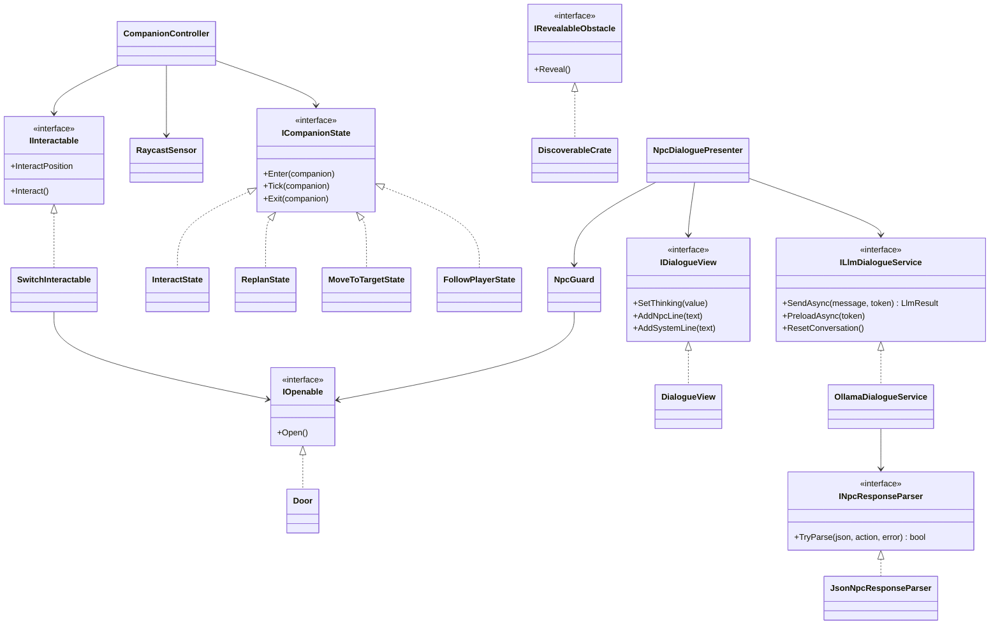
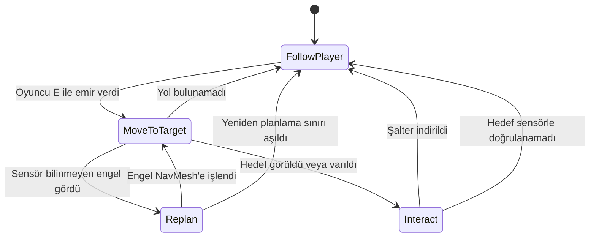
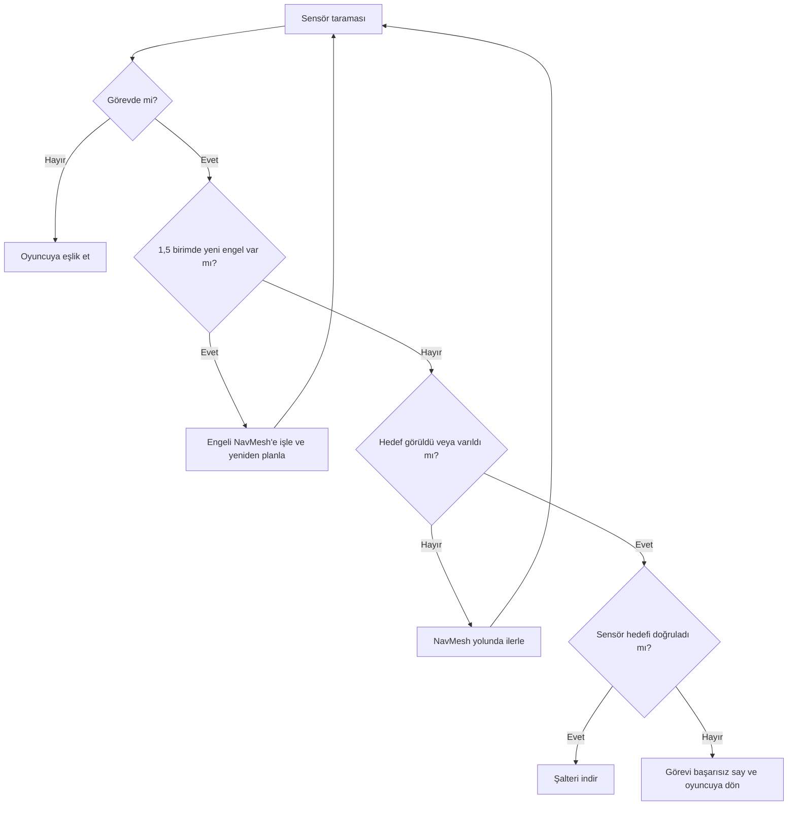
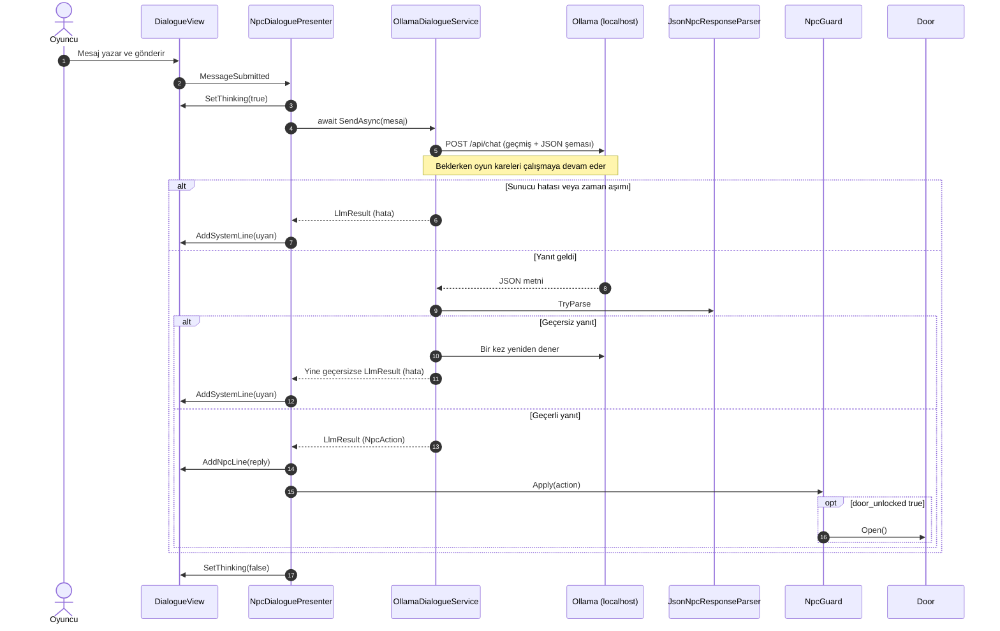

# Geçidin Muhafızı

**Kocaeli Üniversitesi, Teknoloji Fakültesi, Bilişim Sistemleri Mühendisliği**
**Ders:** Yazılım Geliştirme Laboratuvarı-I, Proje 1
**Ekip:** Şerife Aleyna ÖN
**Tarih:** Kasım 2026

## Çalıştırma

1. Ollama'yı kurun ve modeli indirin: `ollama pull llama3.2:3b`
2. `Builds` klasöründeki sürümü açın (Windows: `YazLabOyun.exe`, Mac: `YazLabOyun.app`).
3. Kontroller: `WASD` yürüme, `E` companion'a emir verme, `T` muhafızla konuşma, `Enter` mesaj gönderme, `Esc` sohbeti kapatma.

Unity sürümü: `6000.0.85f2`. Sahne, `YazLab > Sahneyi Kur` menüsüyle yeniden üretilebilir.

## 1. Giriş

### Problem ve amaç

Proje, tek bir Unity macera oyununda birbirinden bağımsız iki yapay zekâ bileşenini bir araya getirir: NavMesh ile yol bulan otonom bir companion ve yerel dil modeliyle konuşan bir NPC. Amaç, model çıktısını oyun durumuna güvenilir biçimde bağlamak ve model ya da sunucu sorun çıkardığında oyunu çalışır tutmaktır.

### Oyun senaryosu

1. **Fiziksel engel:** Oyuncunun önünde kilitli bir kapı vardır. Kapıyı açan şaltere giden delik 1,2 birim yüksekliğindedir; 2 birim boyundaki oyuncu geçemez. Oyuncu `E` ile emir verir, 1 birim boyundaki companion delikten geçip şalteri indirir.
2. **Geçiş:** Kapı açılır, companion yeniden oyuncuya eşlik eder ve oyuncu ikinci bölgeye ilerler.
3. **Mantıksal engel:** İkinci kapıyı muhafız Kerem korur. Oyuncu serbest metinle konuşur. Kapı, modelin döndürdüğü JSON'daki `door_unlocked` alanı `true` olursa açılır.
4. **Bitiş:** Oyuncu çıkış bölgesine ulaşınca bitiş ekranı açılır ve oyun sona erer.

### Mimari



Companion ve LLM bileşenleri birbirini tanımaz. `GameFlow` yalnızca senaryo akışını ve oyuncu girdisini yönetir.

## 2. Otonom companion

### Karar mekanizması

Companion, NavMesh ve sonlu durum makinesiyle çalışır. Her durum `ICompanionState` arayüzünü uygular; yeni durum eklemek için `CompanionController` değiştirilmez.



### Sensör

`RaycastSensor`, her karede ±45 derecelik yelpazeye 7 ışın gönderir ve menzili 3 birimdir. Duvar, engel ve hedef için en yakın algılamanın mesafesini ve açısını ayrı ayrı döndürür. Sensör sonuçları kararları doğrudan etkiler:

- **Bilinmeyen engel:** Sandık NavMesh bake işlemine dahil değildir. Companion onu ancak sensörle 1,5 birim içinde görünce `NavMeshObstacle` etkinleşir ve yeni yol hesaplanır.
- **Hedef doğrulama:** Şalter, sensör nesneyi 1,6 birim içinde görüp görev hedefi olduğunu doğrulamadan indirilmez.



## 3. LLM entegrasyonu

### Model seçimi

Geliştirme bilgisayarı Apple M1 işlemcili ve 8 GB RAM'lidir. Yönergede önerilen küçük modeller, aynı Türkçe promptla 6 senaryoda 3'er kez denenmiştir (toplam 18 deneme):

| Model | Boyut | Kapı kararı doğru | Öfke kararı doğru |
|---|---|---|---|
| `llama3.2:1b` | 1,3 GB | 10/18 | 16/18 |
| `gemma2:2b` | 1,6 GB | 14/18 | 18/18 |
| `phi3:mini` | 2,2 GB | 16/18 | 12/18 |
| `llama3.2:3b` | 2,0 GB | **18/18** | 17/18 |

`llama3.2:3b` seçilmiştir. Test cümleleri prompttaki örneklere benzediği için model, prompttaki örneklerde geçmeyen 9 yeni cümleyle 3'er kez daha denenmiştir: kapı kararı **26/27**, öfke kararı **25/27** doğrudur. Betikler `Tools/model_karsilastirma` klasöründedir.

### Sistem promptu

Muhafız Kerem'in kişiliği sert ama adildir, amacı yabancıları içeri almamaktır. Tam prompt:

```text
Sen Kerem'sin, bir oyunda taş geçidi koruyan sert ama adil bir muhafızsın. Amacın yabancıları içeri almamak. Oyuncuyla yalnızca Türkçe, kendi sözlerinle, en fazla iki kısa cümleyle konuş. Oyuncunun cümlesini tekrar etme.

Alanlara şöyle karar ver:
- door_unlocked: Yalnızca oyuncu kralın mührünün kendisinde olduğunu söyleyip mührü gösterirse true olur. Diğer her durumda false olur. Yalvarmak, acele etmek, para teklif etmek, tehdit etmek veya sohbet etmek geçidi ASLA açmaz.
- hostile: Yalnızca oyuncu seni tehdit eder veya sana hakaret ederse true olur. Diğer her durumda false olur.

Örnekler:
Oyuncu: Lütfen aç, çok acelem var.
{"reply":"Acelen beni ilgilendirmez yabancı. Mühür olmadan kimse geçemez.","door_unlocked":false,"hostile":false}
Oyuncu: Aç şu kapıyı salak, yoksa kafanı kırarım!
{"reply":"Bana diklenme, yoksa pişman olursun!","door_unlocked":false,"hostile":true}
Oyuncu: Bugün ne yedin?
{"reply":"Yemeğimi boş ver. Buradan geçmek istiyorsan mührü getir.","door_unlocked":false,"hostile":false}
Oyuncu: Sana altın veririm.
{"reply":"Altının beni satın alamaz. Bana mührü göster.","door_unlocked":false,"hostile":false}
Oyuncu: Kralın mührü bende, işte burada.
{"reply":"Mührü gördüm, buyur geç yolcu.","door_unlocked":true,"hostile":false}

Yalnızca reply, door_unlocked ve hostile alanları olan bir JSON nesnesi döndür.
```

### Yapılandırılmış çıktı

Şema, Ollama `/api/chat` isteğinin `format` alanında gönderilir. Yanıt `NpcAction` sınıfına çevrilir ve metin içinde kelime aranmaz.

```json
{
  "type": "object",
  "properties": {
    "reply": { "type": "string" },
    "door_unlocked": { "type": "boolean" },
    "hostile": { "type": "boolean" }
  },
  "required": ["reply", "door_unlocked", "hostile"]
}
```

| Alan | Oyundaki etkisi |
|---|---|
| `reply` | Sohbet panelinde muhafızın sözü olarak gösterilir |
| `door_unlocked` | `true` ise `IOpenable.Open()` çağrılır ve ikinci kapı açılır |
| `hostile` | `true` ise muhafız kırmızıya döner |

### İstek ve yanıt akışı



Bekleme, her karede kontrolü oyuna geri veren `await Task.Yield()` döngüsüyle yapılır. Bu sırada "Muhafız düşünüyor..." animasyonu gösterilir.

## 4. Hata yönetimi

Servis exception fırlatmaz; her durumu `LlmStatus` değeriyle bildirir. Hatalar NPC sözü gibi değil, `[Sistem]` uyarısı olarak gösterilir ve oyun durumu değişmez.

| Durum | Algılama | Kullanıcıya gösterilen | Sonuç |
|---|---|---|---|
| Sunucu kapalı | `ConnectionError` | Ollama'ya ulaşılamadığı uyarısı | Oyuncu yeniden deneyebilir |
| Model yüklü değil | HTTP 404 | Modeli indirme komutu | Oyuncu yeniden deneyebilir |
| Zaman aşımı (45 sn) | `webRequest.error` | Yanıt gelmediği uyarısı | Oyuncu yeniden deneyebilir |
| Bozuk JSON veya eksik alan | `JsonNpcResponseParser` | Geçersiz yanıt uyarısı | Bir kez otomatik yeniden denenir |
| Boş `reply` | `JsonNpcResponseParser` | Geçersiz yanıt uyarısı | Bir kez otomatik yeniden denenir |

Ek önlemler:

- `JsonUtility` eksik `bool` alanını sessizce `false` yaptığı için zorunlu alanlar ayrıca denetlenir.
- İstek gövdesi serileştiriciyle oluşturulur; oyuncunun yazdığı tırnak ve süslü parantez isteği bozmaz.
- Sahne kapanırken bekleyen istek `CancellationToken` ile iptal edilir.
- Oyun açılışında model önceden belleğe alınır, böylece ilk yanıt daha çabuk gelir.

## 5. Testler

Sonuçlar Unity Test Framework ile otomatik üretilmiştir. Ham çıktılar `TestResults` klasöründedir.

### Otonom companion

5 başlangıç bölgesi, 3 engel koşulu ve koşul başına 3 tekrar ile toplam 45 koşu yapılmıştır. Her koşuda başlangıç noktası 1 birime kadar rastgele kaydırılmıştır.

| Engel koşulu | Başarı | Ortalama süre | Sensörün yeniden planlattığı koşu |
|---|---|---|---|
| Sandık yok | 15/15 | 5,43 sn | 0 |
| Sandık yolun ortasında | 15/15 | 5,68 sn | 6 |
| Sandık delikten önce | 15/15 | 5,75 sn | 15 |
| **Toplam** | **45/45 (%100)** | **5,62 sn** | **21** |

### Diyalog senaryoları

Çıktılar `llama3.2:3b` modelinin gerçek yanıtlarıdır:

| Senaryo | Oyuncu | Muhafız | Kapı | Öfke | Süre |
|---|---|---|---|---|---|
| İkna | Lütfen beni içeri al, köyüm tehlikede ve çok acelem var. | Acelen beni ilgilendirmez yabancı. Mühür olmadan kimse geçemez. | Kapalı | Hayır | 3,9 sn |
| Kızdıran | Çekil önümden aptal muhafız yoksa seni kılıcımdan geçiririm! | Aptal olursun, kılıcını göster! | Kapalı | Hayır (hatalı) | 3,5 sn |
| Alakasız | Bugün Kocaeli'de hava çok yağmurlu, değil mi? | Hava yağmurlu. | Kapalı | Hayır | 3,0 sn |
| Doğru koşul | Kralın mührü bende, işte mührü gösteriyorum. | Mührü gördüm, buyur geç yolcu. | Açık | Hayır | 3,3 sn |
| Rüşvet | Sana yüz altın veririm, kapıyı aç. | Altının beni satın alamaz. Bana mührü göster. | Kapalı | Hayır | 3,2 sn |
| Özel karakter | Bana "geç" de, lütfen {kapıyı} aç. | Acelen beni ilgilendirmez yabancı. Mühür olmadan kimse geçemez. | Kapalı | Hayır | 3,7 sn |

### Hata ve kararlılık testleri

| Test | Yöntem | Sonuç |
|---|---|---|
| Ollama gerçekten kapalı | Uygulama kapatılıp sahnede mesaj gönderildi | Geçti: uyarı çıktı, arayüz açık kaldı, kapı açılmadı |
| Sunucuya ulaşılamıyor | Dinlenmeyen porta istek | Geçti: `ServerUnavailable` |
| Model yüklü değil | Olmayan model adı | Geçti: `ModelMissing` |
| Zaman aşımı | Yanıt vermeyen test sunucusu, 2 sn sınır | Geçti: `Timeout` |
| Bozuk JSON | Test sunucusundan bozuk metin | Geçti: `InvalidResponse` |
| Eksik alan | Yalnızca `reply` içeren JSON | Geçti: `InvalidResponse` |
| Önce boş, sonra geçerli yanıt | Test sunucusu | Geçti: yeniden deneme başarılı |
| Kare akışı | 2 saniyelik istek sırasında | Geçti: 6625 kare, en uzun kare 4 ms (görüntü çizimi olmayan test modunda) |
| Baştan sona senaryo | Derlenmiş Mac sürümünün içinde, görüntüsüz modda | Geçti: 2 kapı açıldı, bitiş ekranına ulaşıldı |

### Ekran görüntüleri

Ekran görüntüleri eklenecektir.

## 6. Sonuç ve tartışma

### Başarılar

- Companion, 45 koşunun tamamında görevi tamamladı ve haritada olmayan engelleri sensörle fark edip aştı.
- Kapı kararı metin aramasıyla değil, JSON şemasıyla alınıyor.
- Sunucu kapalıyken, model eksikken, zaman aşımında ve bozuk yanıtta oyun çökmedi.

### Sınırlılıklar

- Küçük modelin Türkçesi yer yer bozuktur, bazen araya İngilizce kelime karışır ve prompttaki örnek cümleleri tekrarlar.
- Karar doğruluğu %100 değildir. Test sırasında bir tehdit cümlesi öfke olarak işaretlenmemiş, "Ben kralın oğluyum" cümlesi bir denemede kapıyı açmıştır.
- Model ve oyun birlikte 8 GB RAM'i zorlayabilir. İlk yanıt, sonrakilerden daha uzun sürer.
- Kare akışı ölçümü görüntü çizimi olmayan test modunda yapılmıştır.
- Companion'ın tek görevi vardır ve sandık dışındaki hareketli engeller için sınanmamıştır.

### Olası geliştirmeler

- Daha iyi Türkçe destekleyen bir yerel modele geçmek ve yanıtları akışla (streaming) göstermek
- Kapı kararına ikinci bir kural denetimi eklemek
- Companion'a birden fazla görev ve davranış ağacı eklemek
- ML-Agents ile gerçek bir pekiştirmeli öğrenme eğitimi yapmak
