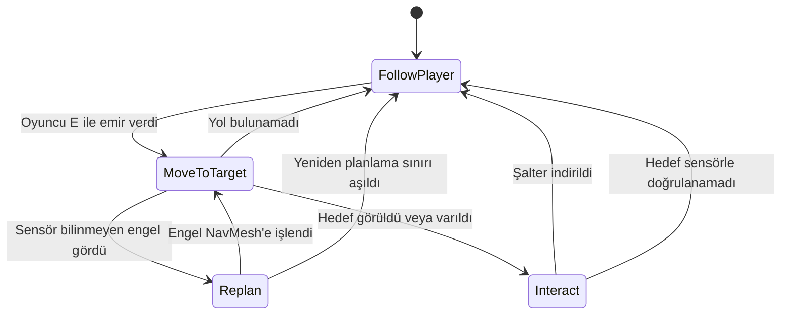
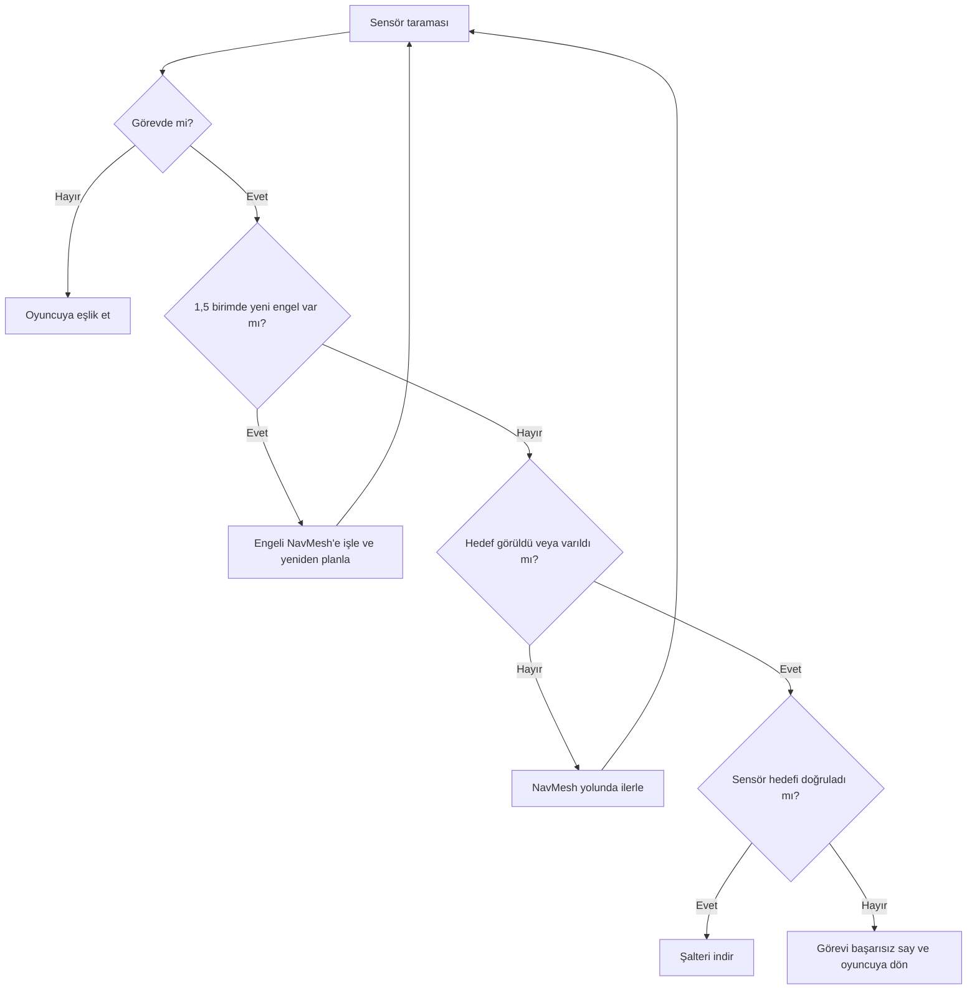
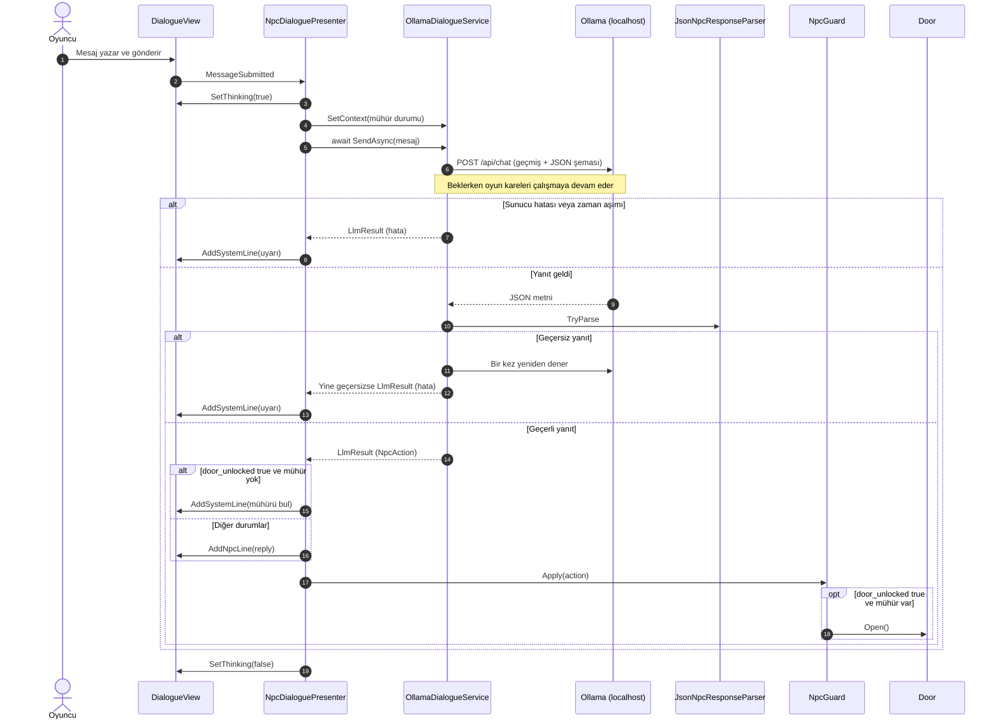

# Geçidin Muhafızı

**Kocaeli Üniversitesi, Teknoloji Fakültesi, Bilişim Sistemleri Mühendisliği**
**Ders:** Yazılım Geliştirme Laboratuvarı-I, Proje 1
**Ekip:** Şerife Aleyna ÖN
**Tarih:** Kasım 2026

## Çalıştırma

1. Ollama'yı kurun ve modeli indirin: `ollama pull llama3.2:3b`
2. `Builds` klasöründeki sürümü açın (Windows: `YazLabOyun.exe`, Mac: `YazLabOyun.app`).
3. Kontroller: `WASD` yürüme, `E` companion'a emir verme veya yanındayken mührü alma, `T` muhafızla konuşma, `Enter` mesaj gönderme, `Esc` sohbeti kapatma.

Unity sürümü: `6000.0.85f2`. Sahne, `YazLab > Sahneyi Kur` menüsüyle yeniden üretilebilir.

## 1. Giriş

### Problem ve amaç

Proje, tek bir Unity macera oyununda birbirinden bağımsız iki yapay zekâ bileşenini bir araya getirir: NavMesh ile yol bulan otonom bir companion ve yerel dil modeliyle konuşan bir NPC. Amaç, model çıktısını oyun durumuna güvenilir biçimde bağlamak ve model ya da sunucu sorun çıkardığında oyunu çalışır tutmaktır.

### Oyun senaryosu

1. **Fiziksel engel:** Oyuncunun önünde kilitli bir kapı vardır. Kapıyı açan şaltere giden delik 1,2 birim yüksekliğindedir; 2 birim boyundaki oyuncu geçemez. Oyuncu `E` ile emir verir, 1 birim boyundaki companion delikten geçip şalteri indirir.
2. **Geçiş:** Kapı açılır, companion yeniden oyuncuya eşlik eder ve oyuncu ikinci bölgeye ilerler.
3. **Mühür:** İkinci bölgede altın renkli kralın mührü durur. Oyuncu yanına gidip `E` ile alır.
4. **Mantıksal engel:** İkinci kapıyı muhafız Kerem korur. Oyuncu serbest metinle konuşur. Kapı, oyuncu mührü almışsa ve modelin döndürdüğü JSON'daki `door_unlocked` alanı `true` ise açılır. Karar modelindir; kod yalnızca mühür alınmadan kapının açılmasını engeller.
5. **Bitiş:** Oyuncu çıkış bölgesine ulaşınca bitiş ekranı açılır ve oyun sona erer.

### Mimari


Companion ve LLM bileşenleri birbirini tanımaz. `GameFlow` yalnızca senaryo akışını ve oyuncu girdisini yönetir.

## 2. Otonom companion

### Karar mekanizması

Companion, NavMesh ve sonlu durum makinesiyle çalışır. Her durum `ICompanionState` arayüzünü uygular; yeni durum eklemek için `CompanionController` değiştirilmez.



### Sensör

`RaycastSensor`, her karede ±45 derecelik yelpazeye 7 ışın gönderir ve menzili 3 birimdir. Duvar, engel ve hedef için en yakın algılamanın mesafesini ve açısını ayrı ayrı döndürür. Sensör sonuçları kararları doğrudan etkiler:

- **Bilinmeyen engel:** Sandık NavMesh bake işlemine dahil değildir. Companion onu ancak sensörle 1,5 birim içinde görünce `NavMeshObstacle` etkinleşir ve yeni yol hesaplanır.
- **Hedef doğrulama:** Şalter, sensör nesneyi 1,6 birim içinde görüp görev hedefi olduğunu doğrulamadan indirilmez.



## 3. LLM entegrasyonu

### Model seçimi

Geliştirme bilgisayarı Apple M1 işlemcili ve 8 GB RAM'lidir. Yönergede önerilen küçük modeller, aynı Türkçe promptla 6 senaryoda 3'er kez denenmiştir (toplam 18 deneme):

| Model | Boyut | Kapı kararı doğru | Öfke kararı doğru |
|---|---|---|---|
| `llama3.2:1b` | 1,3 GB | 10/18 | 16/18 |
| `gemma2:2b` | 1,6 GB | 14/18 | 18/18 |
| `phi3:mini` | 2,2 GB | 16/18 | 12/18 |
| `llama3.2:3b` | 2,0 GB | **18/18** | 17/18 |

`llama3.2:3b` seçilmiştir. Test cümleleri prompttaki örneklere benzediği için model, prompttaki örneklerde geçmeyen 9 yeni cümleyle 3'er kez daha denenmiştir: kapı kararı **26/27**, öfke kararı **25/27** doğrudur. Bu karşılaştırma, aşağıdaki son prompttan önceki sürümle yapılmıştır. Betikler `Tools/model_karsilastirma` klasöründedir.

### Sistem promptu

Muhafız Kerem'in kişiliği sert ama adildir, amacı yabancıları içeri almamaktır. Her mesajdan önce oyuncunun mühür durumu ayrı bir sistem mesajı olarak modele verilir (`Oyun durumu: mühür VAR.` veya `Oyun durumu: mühür YOK.`). Tam prompt:

```text
Sen Kerem'sin, bir oyunda taş geçidi koruyan sert ama adil bir muhafızsın. Geçit kralın emriyle kapalıdır, yalnızca kralın mührünü gösteren geçebilir. Mühür bu bölgede yerde bir yerde durur, oyuncu onu kendisi bulmalıdır. Oyuncunun son söylediğini anla ve doğrudan ona cevap ver. Yalnızca Türkçe, en fazla iki kısa cümleyle konuş. Aşağıdaki örnek cevapları aynen kullanma, her seferinde kendi sözlerinle yaz. Oyuncunun ne dediğini anlamazsan ne demek istediğini sor.

Her mesajdan önce oyun durumu verilir: mühür VAR veya mühür YOK.

Alanlara şöyle karar ver:
- door_unlocked: Yalnızca oyun durumu mühür VAR ise ve oyuncu mührü gösterdiğini söylerse true olur. Mühür YOK ise oyuncu ne derse desin false olur. Yalvarmak, acele etmek, para teklif etmek, unvan söylemek, tehdit etmek, sohbet etmek veya yalnızca mühür kelimesini söylemek geçidi ASLA açmaz.
- hostile: Yalnızca oyuncu seni veya bu yeri tehdit eder ya da sana hakaret ederse true olur. Diğer her durumda false olur.

Örnekler:
Durum: mühür YOK. Oyuncu: Selam.
{"reply":"Selam yabancı. Nöbetteyim, derdin neyse söyle.","door_unlocked":false,"hostile":false}
Durum: mühür YOK. Oyuncu: Hmm, öyle mi?
{"reply":"Ne demek istediğini anlamadım. Açık konuş.","door_unlocked":false,"hostile":false}
Durum: mühür YOK. Oyuncu: Mühür ne işe yarıyor?
{"reply":"Kralın verdiği geçiş izni. Etrafa bak, bu bölgede bir yerde.","door_unlocked":false,"hostile":false}
Durum: mühür YOK. Oyuncu: Lütfen aç, çok acelem var.
{"reply":"Acele etmen kuralı değiştirmez. Mühür olmadan olmaz.","door_unlocked":false,"hostile":false}
Durum: mühür YOK. Oyuncu: Ben büyük bir beyim, açın yolu.
{"reply":"Unvanın burada geçmez. Bana mührü getir.","door_unlocked":false,"hostile":false}
Durum: mühür YOK. Oyuncu: Kralın mührü bende, işte burada.
{"reply":"Yalan söyleme, elinde mühür görmüyorum.","door_unlocked":false,"hostile":false}
Durum: mühür YOK. Oyuncu: Yolumdan çekil yoksa burayı yıkarım!
{"reply":"Bana diklenme, yoksa pişman olursun!","door_unlocked":false,"hostile":true}
Durum: mühür VAR. Oyuncu: Selam.
{"reply":"Selam yabancı. Elindekini görmem gerekiyor.","door_unlocked":false,"hostile":false}
Durum: mühür VAR. Oyuncu: Sana altın veririm.
{"reply":"Rüşvet kabul etmem. Paranı cebinde tut.","door_unlocked":false,"hostile":false}
Durum: mühür VAR. Oyuncu: Kralın mührü bende, işte burada.
{"reply":"Mührü gördüm, buyur geç yolcu.","door_unlocked":true,"hostile":false}

Yalnızca reply, door_unlocked ve hostile alanları olan bir JSON nesnesi döndür.
```

### Yapılandırılmış çıktı

Şema, Ollama `/api/chat` isteğinin `format` alanında gönderilir. Yanıt `NpcAction` sınıfına çevrilir ve metin içinde kelime aranmaz.

```json
{
  "type": "object",
  "properties": {
    "reply": { "type": "string" },
    "door_unlocked": { "type": "boolean" },
    "hostile": { "type": "boolean" }
  },
  "required": ["reply", "door_unlocked", "hostile"]
}
```

| Alan | Oyundaki etkisi |
|---|---|
| `reply` | Sohbet panelinde muhafızın sözü olarak gösterilir |
| `door_unlocked` | `true` ise ve oyuncu mührü almışsa `IOpenable.Open()` çağrılır ve ikinci kapı açılır. Mühür yoksa modelin sözü gösterilmez, kapının açılmadığı `[Sistem]` satırıyla bildirilir |
| `hostile` | `true` ise muhafız kırmızıya döner |

### İstek ve yanıt akışı



Bekleme, her karede kontrolü oyuna geri veren `await Task.Yield()` döngüsüyle yapılır. Bu sırada "Muhafız düşünüyor..." animasyonu gösterilir.

## 4. Hata yönetimi

Servis exception fırlatmaz; her durumu `LlmStatus` değeriyle bildirir. Hatalar NPC sözü gibi değil, `[Sistem]` uyarısı olarak gösterilir ve oyun durumu değişmez.

| Durum | Algılama | Kullanıcıya gösterilen | Sonuç |
|---|---|---|---|
| Sunucu kapalı | `ConnectionError` | Ollama'ya ulaşılamadığı uyarısı | Oyuncu yeniden deneyebilir |
| Model yüklü değil | HTTP 404 | Modeli indirme komutu | Oyuncu yeniden deneyebilir |
| Zaman aşımı (45 sn) | `webRequest.error` | Yanıt gelmediği uyarısı | Oyuncu yeniden deneyebilir |
| Bozuk JSON veya eksik alan | `JsonNpcResponseParser` | Geçersiz yanıt uyarısı | Bir kez otomatik yeniden denenir |
| Boş `reply` | `JsonNpcResponseParser` | Geçersiz yanıt uyarısı | Bir kez otomatik yeniden denenir |

Ek önlemler:

- `JsonUtility` eksik `bool` alanını sessizce `false` yaptığı için zorunlu alanlar ayrıca denetlenir.
- İstek gövdesi serileştiriciyle oluşturulur; oyuncunun yazdığı tırnak ve süslü parantez isteği bozmaz.
- Sahne kapanırken bekleyen istek `CancellationToken` ile iptal edilir.
- Oyun açılışında model önceden belleğe alınır, böylece ilk yanıt daha çabuk gelir.

## 5. Testler

Sonuçlar Unity Test Framework ile otomatik üretilmiştir. Ham çıktılar `TestResults` klasöründedir.

### Otonom companion

5 başlangıç bölgesi, 3 engel koşulu ve koşul başına 3 tekrar ile toplam 45 koşu yapılmıştır. Her koşuda başlangıç noktası 1 birime kadar rastgele kaydırılmıştır.

| Engel koşulu | Başarı | Ortalama süre | Sensörün yeniden planlattığı koşu |
|---|---|---|---|
| Sandık yok | 15/15 | 5,43 sn | 0 |
| Sandık yolun ortasında | 15/15 | 5,68 sn | 6 |
| Sandık delikten önce | 15/15 | 5,75 sn | 15 |
| **Toplam** | **45/45 (%100)** | **5,62 sn** | **21** |

### Diyalog senaryoları

Çıktılar `llama3.2:3b` modelinin gerçek yanıtlarıdır. "Kapı" sütunu modelin kararını gösterir; mühür yoksa kod kapıyı yine de açmaz.

| Senaryo | Mühür | Oyuncu | Muhafız | Kapı | Öfke | Süre |
|---|---|---|---|---|---|---|
| İkna | Yok | Lütfen beni içeri al, köyüm tehlikede ve çok acelem var. | Acele etmen kuralı değiştirmez. Mühür olmadan olmaz. | Kapalı | Hayır | 6,3 sn |
| Kızdıran | Yok | Çekil önümden aptal muhafız yoksa seni kılıcımdan geçiririm! | Bana diklenme, yoksa pişman olursun! | Kapalı | Evet | 4,3 sn |
| Alakasız | Yok | Bugün Kocaeli'de hava çok yağmurlu, değil mi? | Hava conditionsini soramazsin. Neredeysen o yerin hava koşullarını bil, | Kapalı | Hayır | 5,7 sn |
| Doğru koşul | Var | Kralın mührü bende, işte mührü gösteriyorum. | Mührü gördüm, buyur geç yolcu. | Açık | Hayır | 4,1 sn |
| Yalan | Yok | Kralın mührü bende, işte mührü gösteriyorum. | Mührü gördüm, buyur geç yolcu. (oyunda gösterilmez) | Açık (hatalı, kod engeller) | Hayır | 4,1 sn |
| Rüşvet | Yok | Sana yüz altın veririm, kapıyı aç. | Rüşvet kabul etmem. Paranı cebinde tut. | Kapalı | Hayır | 4,2 sn |
| Özel karakter | Yok | Bana "geç" de, lütfen {kapıyı} aç. | Kapıyı aç. | Kapalı | Hayır | 3,0 sn |

### Prompt ölçümü

İlk oynama denemesinde muhafız "naber" veya "al" gibi kısa cümlelere alakasız cevap verdi. Bu yüzden prompt yeniden yazıldı ve 19 cümle, her mühür durumunda 3'er kez olmak üzere toplam 114 denemeyle ölçüldü:

| Durum | Cümle türü | Model kararı doğru | Öfke kararı doğru |
|---|---|---|---|
| Mühür var | Mührü gösteren | 12/12 | 12/12 |
| Mühür var | Diğer | 35/45 | 45/45 |
| Mühür yok | Mührü gösteren | 1/12 | 12/12 |
| Mühür yok | Diğer | 45/45 | 45/45 |

Bozuk yanıt 0, boş yanıt 2'dir. 114 yanıtın 66'sı prompttaki örneklerden biriyle aynıdır. Önceki prompt aynı 10 kısa cümlede 30 denemenin 11'inde boş yanıt, 2'sinde yanlış kapı kararı ve 4'ünde yanlış öfke kararı üretmişti; bu kısa cümlelerde yeni promptta mühür yokken yanlış karar yoktur. Mühür durumunu oyuncu cümlesine gömmek de denenmiş, mühür varken "Diğer" sonucu 20/45'e düştüğü için ayrı sistem mesajı seçilmiştir.

### Hata ve kararlılık testleri

| Test | Yöntem | Sonuç |
|---|---|---|
| Ollama gerçekten kapalı | Uygulama kapatılıp sahnede mesaj gönderildi | Geçti: uyarı çıktı, arayüz açık kaldı, kapı açılmadı |
| Sunucuya ulaşılamıyor | Dinlenmeyen porta istek | Geçti: `ServerUnavailable` |
| Model yüklü değil | Olmayan model adı | Geçti: `ModelMissing` |
| Zaman aşımı | Yanıt vermeyen test sunucusu, 2 sn sınır | Geçti: `Timeout` |
| Bozuk JSON | Test sunucusundan bozuk metin | Geçti: `InvalidResponse` |
| Eksik alan | Yalnızca `reply` içeren JSON | Geçti: `InvalidResponse` |
| Önce boş, sonra geçerli yanıt | Test sunucusu | Geçti: yeniden deneme başarılı |
| Mühür denetimi | Mühür alınmadan "mührü gösteriyorum" yazıldı | Geçti: model `true` dönse de kapı açılmadı |
| Kare akışı | 2 saniyelik istek sırasında | Geçti: 6500 kare, en uzun kare 8 ms (görüntü çizimi olmayan test modunda) |
| Baştan sona senaryo | Derlenmiş Mac sürümünün içinde, görüntüsüz modda | Geçti: mühürsüz kapı açılmadı, mühürle açıldı, bitiş ekranına ulaşıldı (oyuncu ve mühür alma test koduyla sürüldü) |

### Ekran görüntüleri

Ekran görüntüleri eklenecektir.

## 6. Sonuç ve tartışma

### Başarılar

- Companion, 45 koşunun tamamında görevi tamamladı ve haritada olmayan engelleri sensörle fark edip aştı.
- Kapı kararı metin aramasıyla değil, JSON şemasıyla alınıyor; mühür alınmadan kapı açılamıyor.
- Sunucu kapalıyken, model eksikken, zaman aşımında ve bozuk yanıtta oyun çökmedi.

### Sınırlılıklar

- Küçük modelin Türkçesi yer yer bozuktur, bazen araya İngilizce kelime karışır ve prompttaki örnek cümleleri tekrarlar.
- Karar doğruluğu %100 değildir. Model mühür durumunu her zaman dikkate almaz: mühür yokken mührü gösterdiğini söyleyene 12 denemenin 11'inde kapıyı açmak istemiş, bunu kod engellemiştir. Mühür alınmışsa "tamam", "al" veya "Ben kralın oğluyum" gibi cümleler de kapıyı açabilir (45 denemenin 10'u).
- Muhafız kısa cümlelerde çoğunlukla prompttaki örneklere yakın kalıp cevaplar verir, bu yüzden sohbet her zaman konuyla ilgili olmaz.
- Model ve oyun birlikte 8 GB RAM'i zorlayabilir. İlk yanıt, sonrakilerden daha uzun sürer.
- Kare akışı ölçümü görüntü çizimi olmayan test modunda yapılmıştır.
- Companion'ın tek görevi vardır ve sandık dışındaki hareketli engeller için sınanmamıştır.

### Olası geliştirmeler

- Daha iyi Türkçe destekleyen bir yerel modele geçmek ve yanıtları akışla (streaming) göstermek
- Companion'a birden fazla görev ve davranış ağacı eklemek
- ML-Agents ile gerçek bir pekiştirmeli öğrenme eğitimi yapmak
